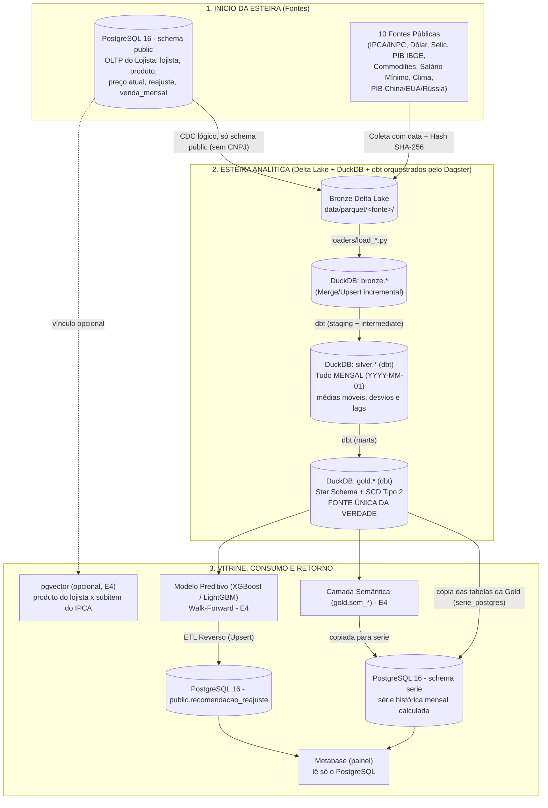
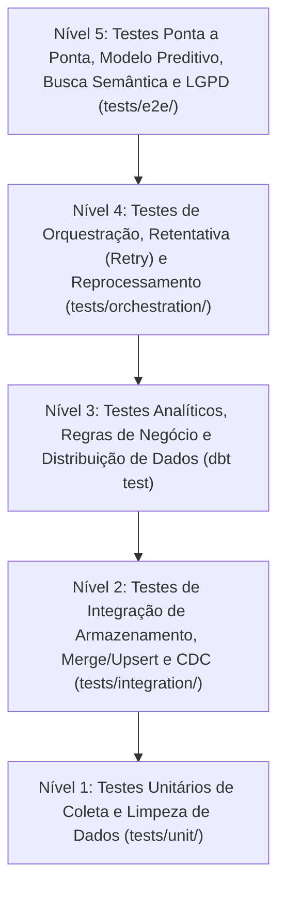

# 🧭 PLANO DIRETOR DE ENGENHARIA E ARQUITETURA — INFLATRACK (`E2 Residual + E3 + E4`)

> **Documento Mestre da Squad Tio IPCA — Sistema de Bancos de Dados 2 (FCTE/UnB — 2026.2)**
> - **Integrantes da Squad:** Artur Fernandes Galdino (`241010923`), João Pedro Lopes da Cruz (`241011170`), Johnnatan de Salles Sanches (`241011330`), Lucas Andrade Zanetti (`241039645`) e Pedro Henrique Américo de Sá (`241025980`).
> - **Prazos Oficiais:** Entrega 3 (`E3`) em **`03/11/2026`** (Semana 13 — 14% da nota) | Entrega 4 (`E4` + Defesa Final) em **`24/11/2026`** (Semana 16 — 14% E4 + 15% Portfólio ADRs + 15% Defesa + 15% Diário de Bordo).

---

## Sumário

1. **Seção 1 — Dicionário de Camadas, Tipos de Tabelas e Contrato de Datas e Tipos**
2. **Seção 2 — Visão da Entrega Final: Plataforma Preditiva, Metabase e Perguntas de Negócio**
3. **Seção 3 — Reorganização Geral e Profissional de Todas as Pastas do Repositório**
4. **Seção 4 — Estratégia de Testes (Pirâmide de 5 Níveis)**
5. **Seção 5 — O que Cada Um Vai Fazer (Divisão das Tarefas do Grupo)**
6. **Seção 6 — Protocolo de Trabalho em Equipe, Git, Uso de IA e Lições Já Aprendidas**

---

## Seção 1 — Dicionário de Camadas, Tipos de Tabelas e Contrato Estrito de Datas e Tipos

Para que todos os 5 integrantes (e seus assistentes de IA) trabalhem em paralelo sem criar arquivos com nomes diferentes ou tabelas incompatíveis, esta seção define o vocabulário único do projeto.

### 1.1 O Que Cada Camada Faz (e o que é proibido fazer nela)

| Camada | Tecnologia | Onde Fica | Responsabilidade Exata (O que faz) | O que é PROIBIDO fazer nela |
| :--- | :--- | :--- | :--- | :--- |
| **0. Banco do Comerciante e Vitrine do Resultado (`OLTP` + série servida)** | PostgreSQL `16` (+ `pgvector` opcional na E4) | Container `db` (`migrations/`) | **Início da esteira (schema `public`):** guarda o que o lojista cadastra (`lojista`, `produto`, `produto_preco_atual`, `reajuste`, `venda_mensal`) e a FK `produto.codigo_subitem_ipca`; suas mudanças saem para a Bronze via **CDC**.<br/>**Vitrine do resultado (schema `serie`, E3/E4):** recebe do DuckDB, já calculadas, as tabelas da Gold que o painel e o lojista consultam (cópia feita por `reverse_etl/exportar_serie.py`, ativo `serie_postgres`), e serve de base para o `EXPLAIN` da E3. **É a única fonte do Metabase.**<br/>**Retorno (E4):** `public.recomendacao_reajuste` via **ETL Reverso**. | O Postgres **nunca calcula** nada: só guarda e serve o que o dbt/DuckDB calculou. O CDC lê **apenas** o schema `public` (nunca `serie`). Só o pipeline escreve em `serie`. Proibido jogar dados brutos das APIs externas nele e proibido `UPDATE` em tabelas históricas (`reajuste`, `venda_mensal`, `observacao`). |
| **1A. Bronze — Respostas Brutas (`Delta Lake`)** | `deltalake` + `pyarrow` | `data/parquet/<fonte>/resposta/` | Guarda o arquivo/resposta original da coleta (JSON, HTML ou conteúdo de ZIP) com a data da coleta e o hash SHA-256 (`id_resposta = hash_corpo`). Se a API devolver o mesmo conteúdo na reexecução, o hash bloqueia a duplicata. | Proibido apagar versões antigas (`VACUUM`) ou gravar respostas vazias/com erro HTTP. |
| **1B. Bronze — Dados Extraídos (`Delta Lake`)** | `deltalake` + `pyarrow` | `data/parquet/<fonte>/<tabela>/` e `data/parquet/transacional/mudanca/` | Transforma a resposta bruta em linhas e colunas tipadas com PyArrow, mantendo **100% dos registros** (marcadores como `...` ou `-` ficam com `valor = NULL` e texto original em `valor_bruto`) mais as 4 colunas de rastreabilidade (`_id_resposta`, `_fonte`, `_requisicao`, `_ingerido_em`). | Proibido filtrar linhas, proibido fazer *forward fill* de calendário aqui e **proibido salvar o `cnpj` do lojista no CDC (LGPD)**. |
| **1C. Bronze no DuckDB (`schema bronze.*`)** | DuckDB `1.1+` | `data/duckdb/inflatrack.duckdb` (`bronze.<fonte>_<tabela>`) | Faz o merge/upsert (ou substituição de partição) levando apenas as informações novas/alteradas do Delta Lake para dentro do DuckDB via `loaders/load_<fonte>.py`, sem nenhuma regra de negócio. | Proibido criar views analíticas, calcular médias ou alterar valores durante a carga para o schema `bronze`. |
| **2A. Silver — Staging (`dbt-duckdb`)** | `dbt-core` + `dbt-duckdb` | `dbt/models/staging/<fonte>/` (`schema silver.*`) | Views SQL 1:1 por fonte que limpam marcadores, preenchem fins de semana/feriados quando necessário (*forward fill* com flag `observado`), tratam datas e preparam as colunas limpas daquela fonte. | Proibido fazer `JOIN` entre fontes diferentes dentro da pasta `staging/`. |
| **2B. Silver — Consolidação Mensal (`dbt-duckdb`)** | `dbt-core` + `dbt-duckdb` | `dbt/models/intermediate/` (`schema silver.*`) | **Crava todas as fontes no grão MENSAL (`mes_referencia = YYYY-MM-01`)**: calcula médias mensais, variações percentuais, médias móveis de 3/6/12 meses, desvio-padrão/volatilidade e defasagens temporais (*lags*). | Proibido expor tabelas `int_*` diretamente para o painel final sem passar pelos Marts da Gold. |
| **3. Gold — Marts Dimensionais (`dbt-duckdb`)** | `dbt-core` + `dbt-duckdb` | `dbt/models/marts/` (`schema gold.*`) | Tabelas materializadas em **Esquema Estrela (*Star Schema*)**: Dimensões (`dim_calendario`, `dim_localidade`, `dim_cesta_ipca_scd2`, `dim_produto_preco_scd2`, `dim_setor_pib`, `dim_commodity`), Fato de Mercado Puro (`fct_inflacao_mensal`) e Fato Comparativo do Lojista (`fct_reajuste_lojista`). A **Gold é a fonte única da verdade**; o Postgres só recebe cópia. | Proibido misturar os produtos privados do lojista dentro da `fct_inflacao_mensal` (o cruzamento do lojista ocorre exclusivamente em `fct_reajuste_lojista`). |
| **4. Consumo, Predição e ETL Reverso (`E4`)** | Camada Semântica + `XGBoost`/`LightGBM` + **Metabase** | `dbt/models/semantic/`, `src/inflatrack/predicao/`, `src/inflatrack/reverse_etl/`, `docker-compose.yml` (Metabase) | Centraliza as métricas oficiais (`gold.sem_*`), treina o modelo preditivo com validação temporal (*walk-forward*), devolve o preço sugerido para o PostgreSQL (ETL Reverso) e exibe os dashboards no **Metabase**, que lê só o PostgreSQL (`serie` e, na E4, `public.recomendacao_reajuste`). | Proibido usar divisão aleatória (`train_test_split` comum) no treino do modelo preditivo, pois destrói a ordem cronológica das séries temporais. Proibido conectar o Metabase ao arquivo do DuckDB: uma conexão aberta trava o dbt e os loaders. |

---

### 1.2 Taxonomia dos 8 Tipos de Tabelas que Vamos Trabalhar

| # | Tipo de Tabela | Banco / Motor | Padrão de Nome | Comportamento de Escrita | Exemplo no Projeto |
| :-: | :--- | :--- | :--- | :--- | :--- |
| **1** | **Cadastro Operacional (OLTP)** | PostgreSQL (`public`) | `<entidade>` | CRUD com `REPLICA IDENTITY FULL` (gera eventos para o CDC) | `lojista`, `produto`, `produto_preco_atual` |
| **2** | **Histórico Imutável (OLTP)** | PostgreSQL (`public`) | `<evento>` | *Insert-Only* (nunca sofre `UPDATE` nem `DELETE`) | `reajuste`, `venda_mensal`, `observacao` |
| **3** | **Log Bruto de Respostas** | Delta Lake | `<fonte>_resposta` | *Append-Only* deduplicado pelo hash SHA-256 do conteúdo | `dolar_resposta`, `ipca_resposta`, `clima_resposta` |
| **4** | **Tabela Bruta Extraída** | Delta Lake & DuckDB (`bronze.*`) | `bronze.<fonte>_<tabela>` | Merge/Upsert de novos registros (`acrescenta`) ou troca de partição (`substitui`) | `bronze.dolar_boletim`, `bronze.ipca_observacao`, `bronze.transacional_mudanca` |
| **5** | **View de Limpeza Silver (`Staging`)** | DuckDB (`silver.*`) | `silver.stg_<fonte>__<entidade>` | View SQL limpa 1:1 com a fonte | `silver.stg_dolar__cotacao_diaria`, `silver.stg_ipca__observacao` |
| **6** | **View de Agregação Mensal (`Intermediate`)** | DuckDB (`silver.*`) | `silver.int_<fonte>__mensal` | View SQL cravada no grão `mes_referencia = YYYY-MM-01` com médias móveis e *lags* | `silver.int_macroeconomia__mensal`, `silver.int_clima__anomalia_mensal` |
| **7** | **Dimensão e SCD Tipo 2 (`Gold`)** | DuckDB (`gold.*`) | `gold.dim_<entidade>` / `gold.dim_<entidade>_scd2` | Tabela materializada; SCD2 guarda `vigencia_inicio`, `vigencia_fim` e `versao_atual` | `gold.dim_calendario`, `gold.dim_cesta_ipca_scd2`, `gold.dim_produto_preco_scd2` |
| **8** | **Tabela Fato / Semântica / Retorno (`Gold` & `OLTP`)** | DuckDB (`gold.*`) e Postgres (`public`) | `gold.fct_<processo>`, `gold.sem_*`, `public.recomendacao_reajuste` | Tabela materializada no DuckDB; `serie.*` é cópia recriável da Gold; retorno operacional via Upsert no PostgreSQL | `gold.fct_inflacao_mensal`, `gold.fct_reajuste_lojista`, `serie.serie_mensal`, `public.recomendacao_reajuste` |

---

### 1.3 Contrato de Datas, Granularidade Mensal e Tipos de Dados

1. **A Data que Une Todos os Dados (`mes_referencia = YYYY-MM-01`):**
   * Toda tabela mensal no projeto usa obrigatoriamente o **primeiro dia do mês (`DATE 'YYYY-MM-01'`)** como chave `mes_referencia`.
   * **Por que cravar tudo em mensal na Silver/Gold (Recomendação do Monitor)?** Porque um comerciante não remarca o preço da prateleira a cada oscilação diária do dólar, e porque o IPCA (nosso alvo central) é mensal. Ao consolidar Dólar, Selic, Clima e Commodities em resumos mensais (média do mês, fechamento do mês, média móvel de 3 e 6 meses, desvio-padrão mensal e variações mensais), todas as fontes passam a ter exatamente a mesma chave `mes_referencia`!
2. **Alinhamento Temporal do PIB e do Clima (Evitando Distorções no Modelo Preditivo):**
   * **PIB (Trimestral):** O PIB divulgado em outubro refere-se ao trimestre anterior encerrado. Na Silver (`int_pib__mensal`), o valor trimestral é alinhado aos meses que ele efetivamente representa e recebe defasagem de publicação (*lag*) para a predição.
   * **Clima (Diário $\rightarrow$ Mensal com *Lag*):** Uma seca ou tempestade hoje afeta a colheita e o preço dos alimentos nos meses seguintes. Por isso, `int_clima__anomalia_mensal` calcula a média móvel trimestral, o desvio-padrão e as variáveis defasadas em `t-1`, `t-2` e `t-3` meses.
3. **Granularidade Declarada de Cada Fato (exigência da E3):** toda tabela fato diz por extenso o que uma linha representa. Ex.: `fct_inflacao_mensal` = uma linha por **subitem × localidade × mês**; `fct_reajuste_lojista` = uma linha por **produto do lojista × mês**; `serie.serie_mensal` = uma linha por **indicador × localidade × mês**. A frase fica no `.yml` do modelo.
4. **Padronização de Tipos Numéricos e de Texto:**
   * **Dinheiro, Índices e Taxas:** Usar sempre `DECIMAL` / `NUMERIC` exato (nunca `FLOAT` em camadas analíticas finais):
     * `DECIMAL(28, 13)` para o número-índice histórico do IPCA (série 1737, que chega a $10^{-9}$ em dez/1979);
     * `DECIMAL(18, 6)` para cotações do Dólar PTAX, Taxa Selic diária e fatores acumulados;
     * `DECIMAL(14, 2)` para preços de produtos em Reais, Salário Mínimo e Cesta Básica;
     * `DECIMAL(12, 4)` para variações percentuais mensais/acumuladas e pesos da cesta.
   * **Códigos de Categorias, Setores, Estações e Países:** Sempre `VARCHAR` / `STRING` (ex.: `'1101002'`, `'A001'`, `'CHN'`), nunca `INT`, para não perder zeros à esquerda.

---

## Seção 2 — Visão da Entrega Final: Plataforma Preditiva, Metabase e Perguntas de Negócio

### 2.1 Onde Queremos Chegar (O Produto Completo na Entrega 4)

A nossa entrega final é uma **Plataforma Analítica e Preditiva para Comerciantes**. O PostgreSQL segue como banco transacional em paralelo (conforme a documentação de arquitetura) e a análise acontece toda no DuckDB:



### 2.2 Isolamento Seguro entre Dados do Comerciante e Dados Oficiais do IPCA
* **O IPCA oficial nunca é alterado pelo lojista:** A tabela `gold.fct_inflacao_mensal` contém apenas os dados públicos oficiais do IBGE cruzados com Dólar, Selic, Clima, PIB e Salário Mínimo.
* **O cruzamento acontece por comparação (`LEFT JOIN`):** Na tabela `gold.fct_reajuste_lojista`, cada produto do comerciante (vindo do PostgreSQL via CDC) aponta para o código do subitem correspondente do IPCA (`codigo_subitem`), comparando lado a lado o reajuste que o comerciante aplicou vs. a inflação oficial daquele subitem na cidade dele.

* **Separação física dentro do Postgres:** o que o lojista cadastra fica em `public` e a série oficial calculada fica em `serie`. O lojista (papel `lojista_app`) só **lê** `serie` e só enxerga as **próprias linhas** de `public` (RLS). Quem escreve em `serie` é apenas o papel do pipeline. Assim, um "leite" cadastrado de forma estranha afeta só a loja dele e nunca o IPCA.
* **Sem laço de retroalimentação:** o CDC publica somente as tabelas de `public`, então o que o pipeline grava em `serie` não volta para a Bronze.

### 2.3 As 5 Perguntas Centrais de Gestão + As 11 Consultas Analíticas (`C1`–`C11`)
Já na **Entrega 3**, a camada Gold no DuckDB responderá diretamente às **5 perguntas principais do projeto** (e às consultas detalhadas `C1` a `C11` de [`docs/visaoGeral/consultas.md`](docs/visaoGeral/consultas.md)):
1. **Inflação acumulada do setor do lojista nos últimos 12 meses** (`C1` / `fct_inflacao_mensal`): variação acumulada de 12 meses por grupo/subitem e localidade.
2. **Sazonalidade e períodos históricos de pico de inflação dos insumos** (`C1` / `C7` / `fct_inflacao_mensal`): agrupamento por mês do ano mostrando os meses historicamente mais críticos para cada subitem e o efeito climático.
3. **Impacto acumulado de 2006 até hoje no poder de compra da categoria** (`C4` / `C9` / `fct_inflacao_mensal` + `stg_salario_minimo__mes`): evolução histórica encadeada (séries `2938`, `1419`, `7060` e `1737`) frente ao salário mínimo nominal e necessário do DIEESE.
4. **Diferença entre a inflação geral (Brasil) e a inflação regional/estadual do lojista nos últimos 5 anos** (`C1` / `C2` / `fct_inflacao_mensal` $\bowtie$ `dim_localidade`): comparativo entre o índice nacional e a região metropolitana do comerciante, além do recorte IPCA vs. INPC.
5. **Taxa de reajuste mínima necessária para não perder margem operacional** (`C5` / `C11` / `fct_reajuste_lojista` + `recomendacao_reajuste`): cálculo da defasagem acumulada de cada produto do lojista frente ao subitem oficial e projeção preditiva para o próximo mês.

---

## Seção 3 — Reorganização Geral e Profissional de Todas as Pastas do Repositório

Uma inspeção completa de **todas as pastas de `inflatrack/`** mostrou que hoje existem arquivos de rascunho na raiz, dois arquivos DuckDB diferentes em `data/`, scripts SQL legados espalhados entre `scripts/` e `sql/`, 33 arquivos Python misturados no mesmo nível dentro de `src/inflatrack/`, e páginas de documentação fora do menu do MkDocs.

Esta seção define a **organização limpa e definitiva de todos os 10 diretórios do projeto** para que ninguém crie arquivos no lugar errado.

Todo arquivo novo criado por qualquer integrante da Squad deve respeitar exatamente os caminhos abaixo:

```text
inflatrack/
├── .dagster/
│   └── dagster.yaml                                # Configuração de armazenamento local de runs do Dagster
├── .github/
│   └── workflows/
│       ├── ci.yml                                  # [NOVO] Executa ruff, pytest e dbt build a cada Push/PR
│       └── docs.yml                                # Publicação automática do MkDocs no GitHub Pages
├── .env.example                                    # Exemplo das variáveis (Postgres, Alpha Vantage, Metabase)
├── .gitignore                                      # Ignora .env, data/parquet/, data/duckdb/, target/, dbt_packages/
├── AI-USAGE.md                                     # Registro obrigatório de uso de IA da Squad
├── PLAN_E3_E4.md                                   # [ESTE DOCUMENTO] Plano Diretor da Squad Tio IPCA
├── README.md                                       # Manual principal: como subir tudo do zero com 1 comando
├── dbt_project.yml                                 # [NOVO E3] Configuração do projeto dbt apontando para a pasta dbt/
├── profiles.yml                                    # [NOVO E3] Conexão do dbt com data/duckdb/inflatrack.duckdb
├── docker-compose.yml                              # [ATUALIZAR] PostgreSQL 16 (wal_level=logical; imagem com pgvector só se a E4 confirmar), Adminer e Metabase (profile bi, porta 3001, sem acesso ao DuckDB)
├── justfile                                        # Automação: just check, just bronze, just dbt, just e3, just e4
├── mkdocs.yml                                      # Menu completo da documentação sem páginas órfãs
├── pyproject.toml                                  # Dependências gerenciadas pelo uv
│
├── migrations/                                     # Scripts SQL de inicialização e evolução do PostgreSQL (OLTP)
│   ├── 0001_referencia_ipca.sql                    # Tabelas de referência do IBGE e observacao
│   ├── 0002_lojista.sql                            # Tabelas lojista, produto, reajuste e produto_preco_atual
│   ├── 0003_seed_referencia.sql                    # Carga inicial de fontes, variáveis, unidades e localidades
│   ├── 0004_evolucao_oltp_cdc_e_consultas.sql      # [NOVO E3] Precisão 1737, vigência (SCD2), venda_mensal e REPLICA IDENTITY FULL
│   ├── 0005_serie_historica.sql                    # [NOVO E3] Schema serie (serie_mensal) + índices usados no EXPLAIN
│   └── 0006_reverse_etl_rls_e_pgvector.sql         # [NOVO E4] recomendacao_reajuste, permissões/RLS por lojista e pgvector (opcional)
│
├── data/                                           # Dados locais (não versionados no Git)
│   ├── duckdb/
│   │   └── inflatrack.duckdb                       # [ÚNICO BANCO ANALÍTICO] Contém schemas bronze, silver e gold
│   └── parquet/                                    # [CAMADA BRONZE EM DELTA LAKE]
│       ├── ipca/              (resposta/, observacao/, metadados/)
│       ├── dolar/             (resposta/, boletim/)
│       ├── selic/             (resposta/, taxa_dia/)
│       ├── pib/               (resposta/, valor/)
│       ├── commodities/       (resposta/, cotacao/)
│       ├── salario_minimo/    (resposta/, mes/)
│       ├── clima/             (resposta/, estacao/, medicao/)
│       ├── pib_china/         (resposta/, indicador/)
│       ├── pib_usa/           (resposta/, indicador/)
│       ├── pib_russia/        (resposta/, indicador/)
│       └── transacional/      (mudanca/)           # Mudanças capturadas do PostgreSQL via CDC (sem CNPJ)
│
├── dbt/                                            # [NOVO E3] Transformação e Modelagem Analítica (dbt-duckdb)
│   ├── README.md                                   # [PRONTO] Guia curto: como levar a sua fonte até a Silver
│   ├── macros/
│   │   ├── gerar_schema_name.sql                   # [PRONTO] Macro generate_schema_name: schemas silver e gold sem prefixo main_
│   │   └── forward_fill_calendario.sql             # Preenchimento de dias sem cotação (ADR 0003)
│   ├── seeds/                                      # Tabelas estáticas de domínio e amarração (CSV)
│   │   ├── _seeds.yml
│   │   ├── seed_localidade_ibge.csv                # 17 regiões metropolitanas/capitais do IPCA
│   │   ├── seed_variavel_sidra.csv                 # Códigos das variáveis do SIDRA
│   │   ├── seed_pib_setor_catalogo.csv             # Classificação dos 23 setores do PIB (grupo e núcleo)
│   │   ├── seed_commodity_catalogo.csv             # Catálogo das 9 commodities internacionais
│   │   └── seed_de_para_estacao_localidade.csv     # Amarração Estação INMET <-> Localidade do IPCA (Consulta C7)
│   ├── models/
│   │   ├── staging/                                # [SILVER - PARTE 1] Limpeza 1:1 por fonte
│   │   │   ├── ipca/              (_ipca__sources.yml, _ipca__models.yml, stg_ipca__observacao.sql, stg_ipca__metadados.sql)
│   │   │   ├── dolar/             (_dolar__sources.yml, _dolar__models.yml, stg_dolar__cotacao_diaria.sql, stg_dolar__volatilidade_intradiaria.sql)
│   │   │   ├── selic/             (_selic__sources.yml, _selic__models.yml, stg_selic__taxa_diaria.sql)
│   │   │   ├── pib/               (_pib__sources.yml, _pib__models.yml, stg_pib__valor.sql)
│   │   │   ├── commodities/       (_commodities__sources.yml, _commodities__models.yml, stg_commodities__cotacao.sql)
│   │   │   ├── salario_minimo/    (_salario_minimo__sources.yml, _salario_minimo__models.yml, stg_salario_minimo__mes.sql)
│   │   │   ├── clima/             (_clima__sources.yml, _clima__models.yml, stg_clima__estacao.sql, stg_clima__medicao_diaria.sql)
│   │   │   ├── pib_internacional/ (_pib_int__sources.yml, _pib_int__models.yml, stg_pib_internacional__indicador.sql)
│   │   │   └── transacional/      (_transacional__sources.yml, _transacional__models.yml, stg_transacional__mudanca.sql)
│   │   ├── intermediate/                           # [SILVER - PARTE 2] Consolidação no Grão MENSAL (YYYY-MM-01)
│   │   │   ├── int_macroeconomia__mensal.sql       # Média mensal, fechamento, média móvel, volatilidade e Selic acumulada
│   │   │   ├── int_commodities__mensal.sql         # Consolidação mensal das 9 commodities + variações e médias móveis
│   │   │   ├── int_clima__anomalia_mensal.sql      # Chuva/temperatura mensal por localidade + desvio padrão + lags (t-1..t-3)
│   │   │   └── int_pib__mensal.sql                 # Alinhamento temporal correto do trimestre do PIB para os meses passados
│   │   ├── marts/                                  # [GOLD] Esquema Estrela (Dimensões + SCD Tipo 2 + Tabelas Fato)
│   │   │   ├── core/
│   │   │   │   ├── _core__models.yml
│   │   │   │   ├── dim_calendario.sql              # Calendário mestre (1979-2026) com mes_referencia = YYYY-MM-01
│   │   │   │   ├── dim_localidade.sql
│   │   │   │   ├── dim_cesta_ipca_scd2.sql         # [SCD TIPO 2] Histórico de versões e pesos da cesta do IPCA
│   │   │   │   └── fct_inflacao_mensal.sql         # [FATO CENTRAL] IPCA x Localidade x Mês + todas as variáveis explicativas
│   │   │   ├── macro/
│   │   │   │   ├── _macro__models.yml
│   │   │   │   ├── dim_setor_pib.sql
│   │   │   │   ├── dim_commodity.sql
│   │   │   │   ├── fct_macroeconomia_mensal.sql    # Painel macroeconômico consolidado (Dólar, Selic, Salário Mínimo, PIB)
│   │   │   │   └── fct_pib_internacional_anual.sql # Comparativo anual Brasil x China x EUA x Rússia
│   │   │   └── lojista/
│   │   │       ├── _lojista__models.yml
│   │   │       ├── dim_produto_preco_scd2.sql      # [SCD TIPO 2] Vigência histórica de preços dos produtos do lojista
│   │   │       └── fct_reajuste_lojista.sql        # [FATO DO COMERCIANTE] Compara preço/vendas do lojista com o IPCA
│   │   └── semantic/                               # [E4] Camada Semântica de Métricas (Fonte Única da Verdade)
│   │       ├── _semantic__models.yml
│   │       ├── sem_metricas_inflacao.sql           # Métricas prontas para as 5 perguntas de gestão no Metabase
│   │       └── sem_recomendacao_reajuste.sql       # Visão consumida tanto pelo Metabase quanto pelo ETL Reverso
│   └── tests/                                      # Testes SQL de distribuição e regras de negócio do dbt
│       ├── assert_dolar_proporcao_nao_observado_30_35_pct.sql
│       ├── assert_selic_taxa_diaria_faixa_valida.sql
│       ├── assert_ipca_variacao_mensal_sem_salto_absurdo.sql
│       ├── assert_clima_temp_min_menor_igual_max.sql
│       └── assert_scd2_sem_sobreposicao_vigencia.sql
│
├── src/
│   └── inflatrack/
│       ├── __init__.py
│       ├── common/                                 # Utilitários base usados por todas as fontes
│       │   ├── __init__.py
│       │   ├── bronze.py                           # gravar_resposta, acrescentar, substituir_particao, carregar_duckdb
│       │   ├── db.py                               # Conexões padronizadas com PostgreSQL e DuckDB
│       │   └── settings.py                         # Variáveis de ambiente e diretórios padrão
│       ├── clients/                                # Clientes HTTP e extratores de formato bruto
│       │   ├── __init__.py
│       │   ├── sidra.py
│       │   ├── pib.py                              # Extrator da Tabela 1846 do SIDRA (Contas Nacionais)
│       │   ├── dolar_olinda.py
│       │   ├── selic_sgs.py
│       │   ├── alphavantage.py
│       │   ├── worldbank.py
│       │   ├── dieese.py
│       │   └── inmet.py
│       ├── bronze/                                 # Coleta da Fonte -> Gravação nas 2 Tabelas Delta Lake
│       │   ├── __init__.py
│       │   ├── ipca.py
│       │   ├── dolar.py
│       │   ├── selic.py
│       │   ├── pib.py
│       │   ├── commodities.py
│       │   ├── salario_minimo.py
│       │   ├── clima.py
│       │   └── pib_internacional.py
│       ├── loaders/                                # Merge/Upsert do Delta Lake -> DuckDB (schema bronze.*)
│       │   ├── __init__.py
│       │   ├── load_ipca.py
│       │   ├── load_dolar.py
│       │   ├── load_selic.py
│       │   ├── load_pib.py
│       │   ├── load_commodities.py
│       │   ├── load_salario_minimo.py
│       │   ├── load_clima.py
│       │   ├── load_pib_internacional.py
│       │   └── load_transacional.py
│       ├── cdc/                                    # Captura de mudanças do banco do lojista (PostgreSQL)
│       │   ├── __init__.py
│       │   ├── transacional.py                     # Captura novos produtos/preços/vendas e remove CNPJ (LGPD)
│       │   └── simular_mudancas.py                 # Script de demonstração prática do CDC funcionando
│       ├── predicao/                               # [E4] Modelos Preditivos e Busca Semântica
│       │   ├── __init__.py
│       │   ├── modelo_reajuste.py                  # XGBoost / LightGBM com Walk-Forward Validation
│       │   └── casamento_produto_subitem.py        # Sugere o subitem do IPCA para o produto do lojista (similaridade de nomes)
│       └── reverse_etl/                            # [E3/E4] Retorno da Gold para o PostgreSQL
│           ├── __init__.py
│           ├── exportar_serie.py                   # [PRONTO] Copia as tabelas da Gold listadas em TABELAS para o schema serie (o que o Metabase lê)
│           └── exportar_recomendacoes.py           # Grava a sugestão de preço e defasagem em recomendacao_reajuste
│
├── orchestration/                                  # Orquestração Dagster (Rotinas automáticas, Retry e Backfill)
│   ├── __init__.py
│   ├── definitions.py
│   ├── partitions.py
│   ├── schedules.py
│   └── assets/                                     # 1 arquivo por fonte para evitar conflitos de Git
│       ├── __init__.py
│       ├── comum.py
│       ├── ipca.py
│       ├── dolar.py
│       ├── selic.py
│       ├── pib.py
│       ├── commodities.py
│       ├── salario_minimo.py
│       ├── clima.py
│       ├── pib_internacional.py
│       ├── transacional.py
│       ├── dbt_assets.py                           # [PRONTO] Roda os modelos e testes do dbt dentro do Dagster
│       ├── serie.py                                # [PRONTO] Ativo serie_postgres: copia a Gold para o Postgres depois do dbt
│       ├── predicao_reverso.py                     # [NOVO E4] Roda o modelo XGBoost/LightGBM e o ETL Reverso
│       └── checks.py                               # [NOVO E3] Checagens automáticas de volume e atualização
│
├── scripts/
│   ├── gerar_diagramas.py
│   ├── metabase_painel.py                          # [PRONTO] Recria o painel no Metabase pela API a partir de scripts/sql/metabase/
│   ├── init_db.py                                  # Inicialização manual temporária do DuckDB (a ser aposentado pelo dbt)
│   ├── verificar_clone_limpo.sh                    # Testa se o projeto sobe do zero em pasta limpa
│   ├── benchmarks/                                 # Scripts reproduzíveis que geram os números das ADRs
│   └── sql/                                        # Queries de EXPLAIN (antes/depois) e verificação OLTP
│       └── metabase/                               # [PRONTO] Painel versionado: um .sql por pergunta + painel.toml
│
├── tests/                                          # Pirâmide de Testes em Python (pytest: Níveis 1, 2, 4 e 5; o Nível 3 analítico fica em dbt/tests/)
│   ├── conftest.py
│   ├── fixtures/                                   # Arquivos reais de exemplo de todas as fontes
│   ├── unit/                                       # Nível 1: Testes rápidos de coleta e conversão de dados
│   ├── integration/                                # Nível 2: Testes de Delta Lake, DuckDB, CDC e ETL Reverso
│   ├── orchestration/                              # Nível 4: Testes de agendamento, retry e backfill no Dagster
│   └── e2e/                                        # Nível 5: Testes ponta a ponta (Modelo Preditivo, Semântica e LGPD/RLS)
│
└── docs/                                           # Documentação MkDocs (GitHub Pages)
    ├── index.md
    ├── adr/                                        # ADRs do projeto (portfólio de 5; numeração a definir)
    ├── diario/                                     # Diário de Bordo semanal da equipe
    ├── arquitetura/
    ├── fontes/
    ├── dicionario/
    ├── pipeline/
    ├── governanca/                                 # [NOVO E4] Catálogo, Linhagem, Análise LGPD e Controle de Acesso
    └── evidencias/
        ├── e2/
        ├── e3/
        └── e4/
│
├── planos/                                         # Histórico e documentação interna da equipe (fora do MkDocs e do Pages)
│   └── tasks_entrega_2.md
```

### 3.3 Mapa "Arquivo Atual → Destino" (guia da faxina)

Nomes reais do repositório hoje (`cc8c4ef`) e para onde cada um vai:

| Hoje | Destino | Observação |
| :--- | :--- | :--- |
| `src/dados_duck.py` | **remover** | Sai o `DROP TABLE` e o código comentado; `common/db.py` assume as conexões. |
| `src/inflatrack/ingest_<fonte>.py` + `bronze_<fonte>.py` | `src/inflatrack/bronze/<fonte>.py` | Um arquivo por fonte (coleta + gravação nas 2 tabelas Delta). |
| `sidra.py`, `dolar_olinda.py`, `selic_sgs.py`, `alphavantage.py`, `dieese.py`, `inmet.py`, `pib.py` | `src/inflatrack/clients/` | Clientes HTTP. `ingest_pib_china/usa/russia.py` viram um só `worldbank.py` + `bronze/pib_internacional.py`. |
| `bronze.py` | `src/inflatrack/common/bronze.py` | Utilitário comum. |
| `load_<fonte>.py` | `src/inflatrack/loaders/` | Todos passam a ler **só do Delta** e a fazer merge/upsert. |
| `orchestration/` (já na raiz) | continua na raiz | Ganha `dbt_assets.py` e `checks.py`. |
| `tests/test_*.py` (planos) | `tests/unit/`, `tests/integration/`, `tests/orchestration/` | Cada teste vai para o nível correspondente (Seção 4). |
| `scripts/setup_duckdb_*.sql`, `sql/verificar_carga.sql` | `scripts/sql/` | Um `setup_duckdb_*` só é apagado quando nenhum loader o usa mais. Os de PIB e commodities já saíram; os loaders criam a `bronze.*` a partir do Delta. |
| `data/raw/` e Parquets legados | **descontinuar** | Só `data/parquet/<fonte>/` (Delta) permanece. |
| `tasks_entrega_2.md` (raiz) | `planos/tasks_entrega_2.md` | Mantém histórico da E2 sem poluir a raiz nem vazar para o GitHub Pages. |

### 3.4 Propósito Arquitetural de Cada Pasta dentro de `src/inflatrack/`

Para seguir uma **Arquitetura Modular Limpa**, o código dentro de `src/inflatrack/` é separado por responsabilidades bem definidas, sem misturar rede com banco nem gravação com transformação:

| Subpasta | Propósito Arquitetural | O que faz / O que NÃO faz |
| :--- | :--- | :--- |
| **`common/`** | **Utilitários Globais** | Funções compartilhadas por todas as fontes (infraestrutura base). Não possui regras de economia ou de negócio; lida com gravação genérica no Delta Lake, conexões e configurações. |
| **`clients/`** | **Extratores e Clientes HTTP** | **Só fala com a internet.** Cuida de requisições HTTP, paginação na API, tokens, decodificação de JSON/HTML e tratamento de quedas de rede. **NÃO** sabe o que é Delta Lake e **NÃO** acessa DuckDB nem Postgres. |
| **`bronze/`** | **Ingestão Oficial da Camada Bronze** | Consome os clientes em `clients/` e grava os dados brutos nas **duas tabelas Delta Lake** (`resposta/` e dados extraídos em `data/parquet/<fonte>/`). É o único ponto oficial de entrada dos dados externos no Data Lake. |
| **`loaders/`** | **Carga Analítica (Delta $\rightarrow$ DuckDB)** | Lê **exclusivamente** das tabelas Delta Lake da Bronze e faz o merge/upsert incremental no DuckDB (`data/duckdb/inflatrack.duckdb`) no schema `bronze.*`. Não faz download e não acessa a internet. |
| **`cdc/`** *(E3)* | **Captura de Mudanças (Postgres Lojista)** | Captura alterações na base transacional do comerciante (preço, produto, venda), anonimiza o CNPJ (LGPD) e despeja na Bronze. |
| **`predicao/`** *(E4)* | **Modelos Preditivos de ML** | Treinamento dos modelos de Machine Learning (XGBoost/LightGBM) com validação temporal (*walk-forward*) e similaridade semântica de produtos. |
| **`reverse_etl/`** *(E3/E4)* | **Retorno da Gold para o PostgreSQL** | `exportar_serie.py` copia as tabelas da Gold para o schema `serie` (o que o Metabase lê); na E4, `exportar_recomendacoes.py` grava as recomendações de reajuste no PostgreSQL do lojista. **NÃO** calcula nada: só copia o que o dbt calculou. |

### 3.5 Propósito Arquitetural da Pasta `scripts/`

A pasta `scripts/` e suas subpastas concentram os **scripts utilitários de apoio operacional, geração de documentação, auditorias SQL e testes de benchmark de desempenho**. Elas **NÃO** fazem parte do pacote Python de produção (`src/inflatrack/`) e **NÃO** contêm rotinas orquestradas do Dagster:

| Subpasta / Arquivo | Propósito Arquitetural | O que faz / O que NÃO faz |
| :--- | :--- | :--- |
| **`scripts/`** *(raiz)* | **Ferramental Operacional e de Apoio** | Scripts executáveis diretos (CLI/Bash/Python) para tarefas de desenvolvimento, compilação de diagramas de arquitetura (`gerar_diagramas.py`), inicialização de transição (`init_db.py`) e validação de clone limpo (`verificar_clone_limpo.sh`). **NÃO** contém regras de negócio ou de extração de dados. |
| **`scripts/sql/`** | **Auditorias SQL e Planos de Execução** | Armazena scripts SQL de auditoria da base transacional (`verificar_carga.sql`), queries de análise de desempenho (`EXPLAIN (ANALYZE, BUFFERS)`) os DDLs legados de preparação do DuckDB (`setup_duckdb_*.sql`, que só saem quando nenhum loader os usa) e, em `scripts/sql/metabase/`, o painel do Metabase versionado (um `.sql` por pergunta e o `painel.toml`). **NÃO** contém migrações do PostgreSQL (que ficam em `migrations/`) nem modelos do dbt (que ficam em `dbt/models/`). |
| **`scripts/benchmarks/`** | **Estudos de Desempenho e Validação de ADRs** | Scripts reproduzíveis para medição de latência, vazão, concorrência e tempos de resposta que fundamentam numericamente as decisões arquiteturais (ADRs). **NÃO** roda em produção contínua no Dagster nem faz parte da pipeline diária. |

### 3.6 Propósito Arquitetural da Pasta `tests/` (Pirâmide de Testes)

A pasta `tests/` organiza os testes automatizados da aplicação em Python segundo a **Pirâmide de Testes** da Seção 4. Cada nível possui escopo, velocidade e isolamento bem delimitados:

| Subpasta / Nível | Propósito Arquitetural | O que faz / O que NÃO faz |
| :--- | :--- | :--- |
| **`tests/unit/`** *(Nível 1)* | **Testes Unitários Rápidos** | Testa parsers de HTML/JSON, conversões de tipos, normalização de datas e regras de checagem em memória pura, usando mocks (`unittest.mock`) e fixtures locais. **NÃO** faz requisições reais à internet e **NÃO** escreve em disco, Delta Lake ou banco de dados. |
| **`tests/integration/`** *(Nível 2)* | **Integração de Armazenamento e Idempotência** | Testa a gravação física real no Delta Lake e no DuckDB usando diretórios temporários (`tmp_path`), garantindo que reexecuções não duplicam linhas (idempotência), que revisões históricas entram como novas versões e que partições são substituídas corretamente. **NÃO** acessa a internet nem APIs externas. |
| *(Em `dbt/tests/`)* *(Nível 3)* | **Testes Analíticos e Integridade de Dados** | *(Localizado em `dbt/tests/`)* Executado via `dbt test` diretamente sobre o DuckDB para validar integridade referencial, faixas de valores e vigência temporal (SCD2). **NÃO** é executado pelo pytest. |
| **`tests/orchestration/`** *(Nível 4)* | **Orquestração e Agendamento Dagster** | Testa as definições de assets, grafo de dependências, políticas de retry e janela de releitura/backfill das pipelines do Dagster. **NÃO** executa a carga pesada de todas as fontes em disco; valida a topologia e a robustez do pipeline. |
| **`tests/e2e/`** *(Nível 5)* | **Ponta a Ponta e Isolamento (E3/E4)** | Testa o fluxo completo ponta a ponta: do cadastro do produto no PostgreSQL do lojista até o cálculo na Gold e gravação na recomendação de reajuste (ETL Reverso), validando que dados do comerciante nunca alteram as tabelas oficiais e que o modelo preditivo não vaza dados futuros. |
| **`tests/fixtures/`** | **Amostras Reais de Dados (Mock Offline)** | Armazena payloads reais de resposta (`.json`, `.html`, recortes) congelados no tempo para que toda a suíte de testes rode de forma 100% reproduzível, rápida e sem necessidade de conexão com a internet ou chaves de API ativas. |

### 3.7 Propósito Arquitetural da Pasta `orchestration/` (Dagster)

A pasta `orchestration/` centraliza a automação, agendamento temporal e tratamento de falhas de todo o pipeline através do **Dagster**. Para permitir que os 5 integrantes trabalhem em paralelo sem conflitos de merge no Git, as rotinas são estritamente separadas por arquivo:

| Subpasta / Arquivo | Propósito Arquitetural | O que faz / O que NÃO faz |
| :--- | :--- | :--- |
| **`orchestration/definitions.py`** | **Ponto de Entrada do Orquestrador** | Ponto de entrada canônico carregado por `dagster dev`. Usa reflexão (`pkgutil.iter_modules`) para carregar automaticamente todos os módulos de `assets/`, amarra os jobs e schedules na instância `Definitions`. **NÃO** executa pipelines na inicialização e **NÃO** contém regras de extração. |
| **`orchestration/partitions.py`** | **Janelas Temporais e Backfill** | Define as partições temporais (mensais, diárias) e a política de releitura retroativa (`janela_de_releitura`) que volta 3 meses para capturar revisões estatísticas do IBGE. **NÃO** agenda jobs e **NÃO** acessa a internet. |
| **`orchestration/schedules.py`** | **Gatilhos Temporais e Cron** | Declara os jobs (`define_asset_job`) e agendamentos cron por fonte (ex.: dias 9 a 13 às 10h para IPCA, dias úteis às 19h para macroeconomia/BCB após fechamento do mercado). Vincula ao fuso `America/Sao_Paulo`. **NÃO** implementa a lógica do ativo; apenas define quando ele deve rodar. |
| **`orchestration/assets/comum.py`** | **Infraestrutura Compartilhada** | Define o pool de escrita exclusiva do DuckDB (`POOL_DUCKDB`, limite 1 escritor por vez), a política de retentativa automática com recuo exponencial (`RETRY_REDE`) e o wrapper seguro de execução de CLI (`executar`). **NÃO** possui assets de dados econômicos específicos. |
| **`orchestration/assets/<fonte>.py`** | **Definições de Ativos por Fonte (1 por Fonte)** | Declara os ativos `@asset` individuais de cada fonte (`ipca.py`, `dolar.py`, `selic.py`, `pib.py`, `commodities.py`, `salario_minimo.py`, `clima.py`, `pib_internacional.py`). Cada ativo atua como uma casca declarativa chamando o ponto de entrada canônico em `src/inflatrack/`. **NÃO** reimplementa lógica de rede ou de banco. |
| **`orchestration/assets/dbt_assets.py`** *(E3)* | **Integração dbt com Dagster** | Executa os modelos e testes do dbt dentro do grafo de dependências do Dagster via `@dbt_assets`, permitindo disparar transformações Silver/Gold após a conclusão da Bronze. A ligação com o loader de cada fonte vem do `meta.dagster.asset_key` da `source` no dbt. |
| **`orchestration/assets/serie.py`** *(E3)* | **Vitrine no Postgres** | Ativo `serie_postgres`: depois do dbt, copia para o schema `serie` as tabelas da Gold listadas em `exportar_serie.TABELAS`. |
| **`orchestration/assets/checks.py`** *(E3)* | **Asset Checks (Qualidade e Frescura)** | Implementa verificações automatizadas de volume e alertas de dados desatualizados (SLA/Freshness) no Dagster. |

### 3.8 Propósito Arquitetural da Pasta `dbt/` (Modelagem Silver, Gold e Testes Analíticos)

A pasta `dbt/` abriga o projeto analítico do **`dbt-duckdb`**, que transforma os dados brutos da camada Bronze armazenados no DuckDB (`data/duckdb/inflatrack.duckdb`) nas camadas **Silver** (limpeza e consolidação mensal) e **Gold** (esquema estrela dimensional e camada semântica):

| Subpasta / Módulo | Propósito Arquitetural | O que faz / O que NÃO faz |
| :--- | :--- | :--- |
| **`dbt/macros/`** | **Macros Jinja Reutilizáveis** | Funções SQL/Jinja reaproveitáveis (ex.: `gerar_schema_name.sql` para isolar os schemas `silver` e `gold`, e `forward_fill_calendario.sql` para preenchimento de feriados/fins de semana). **NÃO** contém regras de negócio de fontes específicas. |
| **`dbt/seeds/`** | **Tabelas Estáticas de Domínio (CSV)** | Catálogos e domínios fixos (tabelas de/para de estações climáticas e localidades do IPCA, catálogo de commodities, setores do PIB e regiões do IBGE). **NÃO** armazena dados transacionais dinâmicos nem séries temporais. |
| **`dbt/models/staging/`** *(Silver 1:1)* | **Limpeza e Padronização 1:1 por Fonte** | Modelos SQL de padronização direta da Bronze: renomeia colunas para português claro, faz casting de tipos e remove anomalias pontuais. Mantém a granularidade original da fonte. **NÃO** faz `JOIN` entre fontes diferentes e **NÃO** altera o grão dos dados. |
| **`dbt/models/intermediate/`** *(Silver Mensal)* | **Consolidação no Grão Mensal (`YYYY-MM-01`)** | Agrega todas as fontes diárias e trimestrais no grão mensal padronizado: calcula médias móveis, variações percentuais, volatilidade (desvio-padrão) e defasagens (*lags* de 1 a 3 meses para alimentos/clima). **NÃO** cria dimensões ou tabelas fato do esquema estrela. |
| **`dbt/models/marts/core/`** *(Gold Core)* | **Esquema Estrela e Fato Central da Inflação** | Dimensões centrais (`dim_calendario`, `dim_localidade`, dimensão com vigência histórica `dim_cesta_ipca_scd2`) e a tabela fato central `fct_inflacao_mensal`. |
| **`dbt/models/marts/macro/`** *(Gold Macro)* | **Painel Macroeconômico e Cenário Externo** | Dimensões de setores/commodities e tabelas fato `fct_macroeconomia_mensal` (Dólar, Selic, Salário Mínimo, PIB) e `fct_pib_internacional_anual`. |
| **`dbt/models/marts/lojista/`** *(Gold Comerciante)* | **Fato do Lojista e Histórico de Preços** | Dimensão com histórico de preços do lojista (`dim_produto_preco_scd2`) e tabela fato `fct_reajuste_lojista` (compara preço/vendas da loja com o IPCA oficial). |
| **`dbt/models/semantic/`** *(E4 - Semântica)* | **Fonte Única da Verdade para Gestão** | Métricas padronizadas para o Metabase e para o ETL Reverso (inflação acumulada 12m, perda de poder de compra desde 2006, sugestão de reajuste). |
| **`dbt/tests/`** *(Nível 3 da Pirâmide)* | **Testes Analíticos e Regras em SQL** | Testes singulares em SQL para validar regras de negócio que o pytest não enxerga (ausência de sobreposição em SCD2, proporção de não observados no câmbio, valores fora de faixas plausíveis). |

---

## Seção 4 — Estratégia Massiva de Testes ("Testar Tudo sobre Tudo para Tudo" — Pirâmide de 5 Níveis)

Para garantir que nenhuma alteração quebre o trabalho dos colegas e que os dados econômicos e preditivos sejam confiáveis para o comerciante, o projeto adota uma **Pirâmide de 5 Níveis de Testes Automatizados**:



### Nível 1 — Testes Unitários de Coleta e Conversão (`tests/unit/` — `pytest`)
* **O que testa:** Cada função de extração e limpeza isoladamente, usando arquivos de exemplo reais salvos em `tests/fixtures/` (sem depender de internet ou de APIs externas estarem no ar).
* **Regras verificadas:**
  * Conversão correta de números brasileiros (`"1.412,00"` $\rightarrow$ `1412.00`) e datas em múltiplos formatos (`"jan/2024"`, `"202401"`, `"2024-Q3"` $\rightarrow$ `2024-01-01`).
  * **Diferenciação entre Zero Real e Valor Vazio (`NULL`) no Clima:** Garante que `0.0 °C` ou `0.0 mm` de chuva jamais sejam descartados como se fossem dados faltantes, e que códigos de erro do sensor (`-9999`) virem `NULL`.
  * **Remoção de Dados Sensíveis (LGPD):** Verifica se o extrator do banco do lojista remove o CNPJ em texto aberto e mantém apenas o identificador anonimizado (`hash_estabelecimento`).

### Nível 2 — Testes de Integração de Armazenamento e Idempotência (`tests/integration/` — `pytest`)
* **O que testa:** A gravação real no Delta Lake e no DuckDB usando diretórios temporários (`tmp_path`).
* **Regras verificadas:**
  * **Preservação da Resposta Bruta (`resposta/`):** Confirma que o arquivo original baixado da API (ou o `.zip` do clima) foi salvo com a data da coleta.
  * **CDC que de fato vê mudanças:** um script altera, apaga e insere linhas no Postgres e o teste confirma que cada mudança aparece na Bronze (sem CNPJ), inclusive quando o mesmo evento é reprocessado e quando chega atrasado.
  * **Teste de Dupla Execução (Idempotência / Merge-Upsert):**Todo `load_<fonte>.py` é executado **duas vezes seguidas** com o mesmo lote de dados e um registro atualizado. O teste exige que o número total de linhas em `bronze.<fonte>` **não duplique** e que o valor atualizado substitua o anterior.

### Nível 3 — Testes Analíticos, de Integridade e de Distribuição (`dbt/` — `dbt test`)
* **O que testa:** A qualidade das tabelas das camadas **Silver** e **Gold** dentro do DuckDB após as transformações em SQL.
* **Regras verificadas:**
  * **Integridade de Chaves e Relacionamentos:** Chaves primárias únicas e não nulas (`unique`, `not_null`) e integridade referencial (`relationships`) entre as tabelas Fato e todas as Dimensões (`dim_calendario`, `dim_localidade`, `dim_cesta_ipca_scd2`, `dim_produto_preco_scd2`).
  * **Validação de Intervalos e Distribuição Estatística:** Verifica se o IPCA mensal, o câmbio, a Selic, as temperaturas e os pesos da cesta do IPCA estão dentro de faixas reais (sem valores absurdos ou negativos inválidos).
  * **Volume e erro silencioso:** contagem mínima de linhas por tabela e testes do que o domínio tem de sujo (valor negativo onde não cabe, salto absurdo na série, localidade que some entre dois meses) — `not_null` em coluna que nunca é nula não conta.
  * **Testes Singulares de Negócio (`dbt/tests/`):**
    * `assert_scd2_sem_sobreposicao_datas.sql`: Garante que um mesmo produto ou subitem do IPCA nunca tenha duas faixas de vigência abertas ao mesmo tempo.
    * `assert_pib_sem_vazamento_futuro.sql`: Garante que o PIB divulgado pelo IBGE foi alinhado ao trimestre que já passou, sem vazar informação futura para meses anteriores.

### Nível 4 — Testes de Orquestração, Agendamento e Recuperação de Falhas (`tests/orchestration/` — `pytest`)
* **O que testa:** O funcionamento das rotinas automáticas no Dagster.
* **Regras verificadas:**
  * **Grafo Completo Sem Ciclos:** Confirma que todas as fontes Bronze, os modelos Silver/Gold do `dbt` e o modelo preditivo carregam no Dagster sem conflitos de nomes.
  * **Simulação de Queda de API (*Retry Policy*):** Simula uma falha temporária de conexão (`HTTP 503`) e comprova que o Dagster tenta novamente de forma automática.
  * **Reprocessamento Histórico (*Backfill*):** Executa o reprocessamento de meses passados (`2025-10` a `2026-01`) e verifica se as partições são atualizadas sem duplicar linhas.

### Nível 5 — Testes Ponta a Ponta, Modelo Preditivo e Isolamento do Lojista (`tests/e2e/` — `pytest`)
* **O que testa:** O fluxo completo da plataforma, desde a entrada de dados até a recomendação de reajuste no banco do comerciante.
* **Regras verificadas:**
  * **Isolamento entre Comerciante e Dados Oficiais:** Confirma que cadastrar ou alterar o preço de um produto no PostgreSQL do lojista altera apenas a análise da loja dele, sem jamais modificar as tabelas oficiais do IPCA, Dólar, Selic, PIB ou Clima.
  * **Validação Temporal (*Walk-Forward*) do Modelo Preditivo:** Garante que o treino do XGBoost/LightGBM respeita a ordem cronológica (nunca usa meses futuros para prever meses passados) e gera previsões válidas.
  * **Mesma Métrica, Mesmo Valor:** o número de uma métrica no DuckDB, em `serie.*` no Postgres e no painel do Metabase é idêntico.
  * **Retorno ao Lojista (ETL Reverso) e Controle de Acesso:** Verifica se a sugestão de reajuste calculada na Gold é gravada de volta na tabela `recomendacao_reajuste` do PostgreSQL e se um lojista não consegue ler os dados de outro lojista.

---

## Seção 5 — O que Cada Um Vai Fazer (Divisão das Tarefas do Grupo)

Para ninguém ficar travado esperando o outro terminar, combinamos o seguinte: **cada um cuida da sua própria base de dados do começo até a camada Silver**, e depois dividimos as partes gerais do projeto (modelagem final, painel no Metabase, inteligência artificial e documentação) de forma justa entre os cinco.

---

### 5.0 O Caminho do Dado e o que Todo Mundo Precisa Fazer na sua Fonte

Para que todos sigam rigorosamente a mesma esteira de ponta a ponta e saibam o que verificar, este é o **caminho oficial obrigatório** que o dado de cada fonte deve percorrer:

1. **Coleta na Fonte:** Baixar os dados brutos da API/site externo usando o cliente Python isolado em `src/inflatrack/clients/`.
2. **Bronze no Delta Lake:** Salvar os dados brutos originais em Parquet na pasta `data/parquet/<sua_fonte>/` (preservando o histórico sem filtros analíticos e com hash SHA-256).
3. **Bronze no DuckDB:** Criar/executar o carregador em `src/inflatrack/loaders/load_<sua_fonte>.py` para inserir os dados na tabela `bronze.<sua_fonte>` do DuckDB via merge/upsert (o jeito mais simples é `common.bronze.carregar_duckdb`, como em `load_pib.py`).
4. **Silver Staging (`dbt`):** Criar a view SQL de limpeza 1:1 em `dbt/models/staging/<sua_fonte>/` (`silver.stg_<sua_fonte>__...`), tratando tipos, marcadores e nulos. O passo a passo está em `dbt/README.md`.
5. **Silver Intermediária (`dbt`):** Consolidar os dados no grão mensal em `dbt/models/intermediate/` (`silver.int_<sua_fonte>__mensal`), fixando a chave sempre no 1º dia do mês (`mes_referencia = YYYY-MM-01`) e calculando médias móveis, variações e lags.
6. **Gold Marts (`dbt`):** Cruzar os dados nas tabelas finais em `dbt/models/marts/` (Dimensões e Fatos da camada `gold.*`).
7. **Postgres e Metabase:** As tabelas da Gold que o painel usa são copiadas para o schema `serie` do PostgreSQL (basta pôr o nome em `exportar_serie.TABELAS`), e o Metabase lê só de lá. Cada pergunta do painel é um `.sql` em `scripts/sql/metabase/` (veja o `README.md` dessa pasta).

**O que cada integrante deve verificar e testar na sua parte:**
* Se o download roda de forma isolada e grava com sucesso no Delta Lake.
* Se o loader insere e atualiza no DuckDB sem duplicar linhas ao rodar duas vezes seguidas (idempotência).
* Se a compilação e os testes do dbt (`uv run dbt build` / `uv run dbt test`) passam com 100% de sucesso.

---

#### 5.0.1 Regras de Ouro para a Fonte de Cada Integrante

Antes das tarefas específicas, todo integrante garante estas 5 coisas na fonte que já vem cuidando desde o começo do semestre:

1. **Guardar o arquivo original com a data em que foi baixado:**
   * Sempre que o script buscar dados na internet, salva primeiro a resposta original (ou o `.zip`, no caso do clima) em `resposta/`, marcada com a data da coleta, e só depois grava a tabela em Delta Lake. Sempre que possível, busca a **série completa** e preenche o que faltar com *backfill*, para ficar rastreável.
2. **Carregar os dados no DuckDB sem apagar o que já estava lá:**
   * Atualizar só o que for novo ou mudou (merge/upsert). Ninguém dá `DROP TABLE` e recria do zero. A fonte também deixa de usar a pasta `data/raw/` e os Parquets antigos.
3. **Limpar os dados e deixar tudo agrupado por mês na camada Silver:**
   * Um comerciante não muda o preço da prateleira porque o dólar caiu num único dia ou porque choveu numa terça-feira. Por isso a Silver fica **mês a mês** (sempre o dia `01` como referência).
   * Quem cuida de dados diários (Dólar, Selic, Clima e Commodities) resume o mês com **média**, **variação do período**, **média móvel** (tendência) e **desvio-padrão** (mês calmo ou instável).
4. **Criar os testes da sua própria fonte:**
   * Testes que provem que a coleta funciona, que rodar o carregador duas vezes não duplica linhas e que o dado não tem as sujeiras típicas dele (valor negativo, salto na série, mês que some).
5. **Registrar a sua parte no diário de bordo toda semana:**
   * Poucas linhas em `docs/diario/`: o que você mediu, o que te surpreendeu e o que decidiu.

---

### 5.1 Lucas — *IPCA/INPC, Banco do Lojista (PostgreSQL), CDC e Tabelas Principais da Gold*

* **O que ficou pendente de antes:**
  * **Em `bronze/`:** Fundir `ingest.py` + `bronze_ipca.py` → `ipca.py`.
  * **Em `loaders/`:** Criar `loaders/load_ipca.py` e o loader transacional `loaders/load_transacional.py`.
  * **Em `cdc/`:** Implementar `cdc/transacional.py` e `cdc/simular_mudancas.py` (capturar novos produtos/preços/vendas e remover CNPJ via LGPD; demonstrar reprocessamento e chegada atrasada). A decisão de ingestão (CDC × lote) fica registrada num ADR (numeração a definir).
  * **Em `tests/`:** Separar os testes de `test_ipca.py`: manter a checagem e parsing puro de respostas do SIDRA em `tests/unit/test_ipca.py` e os testes de gravação em Delta Lake (`resposta` e `observacao`) e idempotência em `tests/integration/test_ipca.py`.
  * **Em `orchestration/assets/`:** Extrair as rotinas de `ipca`, `inpc` e `ipca_numero_indice` de `orchestration/assets/ingestao.py` para um módulo próprio e isolado `orchestration/assets/ipca.py`.
  * Fechar o histórico de classificação do IPCA, que hoje ainda sobrescreve o valor antigo.
* **Para a Entrega 3 (até 03/11):**
  * **Deixar o IPCA e os dados do lojista limpos por mês na Silver.**
  * **Guardar o histórico de mudanças de preços e pesos (SCD Tipo 2):** uma tabela para quando o IBGE muda o peso de um produto na cesta e outra para cada vez que o lojista altera preço ou custo.
  * **Montar as tabelas principais da Gold**, cada uma com a frase do que uma linha representa: a de inflação mensal (perguntas 1, 2 e 4) e a de reajuste do lojista (pergunta 5).
  * **Preparar a vitrine no Postgres:** a cópia da Gold para o schema `serie` já existe (`exportar_serie.py`). Falta pôr as suas tabelas da Gold na lista `TABELAS` (é isso que faz as perguntas 1, 2, 4 e 5 aparecerem no painel) e criar a migration `0005` com as permissões e o índice que você vai medir no `EXPLAIN`.
  * **Comparar a consulta antes e depois (`EXPLAIN (ANALYZE, BUFFERS)`):** rodar no PostgreSQL, sobre a série, sem índice e com índice, salvar os scripts/queries em `scripts/sql/` e guardar os dois planos em `docs/evidencias/e3/`.
* **Para a Entrega 4 (até 24/11):**
  * **Travar o acesso no banco do lojista:** cada lojista só enxerga os próprios produtos e recomendações, com privilégio mínimo, e uma demonstração disso.
  * **Gravar a recomendação de reajuste no Postgres (lado do banco do ETL Reverso):** definir quem lê essa tabela e o que a pessoa faz com ela, se o pipeline empurra ou o destino puxa, com que frequência, e o que acontece quando o Postgres está fora do ar.
  * **Teste do lojista de ponta a ponta:** cadastrar um produto, rodar o processo e provar que só a recomendação da loja dele muda, sem mexer nos dados oficiais.

---

### 5.2 Pedro — *Dólar, Selic, Organização do Repositório, Rotinas do Dagster e Métricas*

* **O que ficou pendente de antes:**
  * **Arrumar a casa:** mover os arquivos para as pastas certas seguindo o mapa da Seção 3.3, confirmar a remoção de `dados_duck.py` e deixar o `ruff` sem nenhum erro.
  * **Em `scripts/`:** Criar `scripts/sql/`, mover os 6 scripts `setup_duckdb_*.sql` e `sql/verificar_carga.sql` para lá, atualizar `scripts/init_db.py` e a receita `verificar-carga` do `justfile`, eliminando a pasta raiz legada `sql/`.
  * **Em `tests/`:** Concluir a reorganização dos 18 arquivos na pirâmide da Seção 4; no futuro, separar os testes de carga em memória do DuckDB de `test_dolar_olinda.py` e `test_selic_sgs.py` para os novos testes de integração de `loaders/load_dolar.py` e `loaders/load_selic.py` em `tests/integration/`.
  * **Em `clients/`:** Já possui `dolar_olinda.py` e `selic_sgs.py` redondos e testados.
  * **Em `bronze/`:** Fundir `ingest_dolar.py` + `bronze_dolar.py` → `dolar.py`, e `ingest_selic.py` + `bronze_selic.py` → `selic.py`, para que cada fonte tenha um ponto único de entrada gravando direto em Delta Lake.
  * **Em `loaders/`:** Criar os loaders `loaders/load_dolar.py` e `loaders/load_selic.py` (hoje não existem carregadores Delta → DuckDB para eles).
  * **Em `orchestration/assets/`:** Extrair os assets de Dólar e Selic de `orchestration/assets/ingestao.py` para seus próprios módulos `assets/dolar.py` e `assets/selic.py`.
  * **Aposentar o inicializador manual:** apagar cada `scripts/sql/setup_duckdb*.sql` só quando nenhum loader o usar mais (o dbt não cria a Bronze), e o `scripts/init_db.py` quando não sobrar nenhum.
  * Rever o ADR do calendário civil diário, que agora convive com a regra de "tudo mensal".
* **Para a Entrega 3 (até 03/11):**
  * **Transformar Dólar e Selic em resumos mensais na Silver**, com média, fechamento, variação, média móvel e desvio-padrão.
  * **Cruzar câmbio e juros na Gold** (pressão macroeconômica sobre a inflação).
  * **Deixar as rotinas do Dagster redondas:** quanto em quanto tempo cada fonte roda, na ordem certa de dependência.
  * **Declarar a frescura dos dados:** um alerta de atualização e um SLA escrito para pelo menos uma tabela de consumo.
  * **Escrever a Release Notes da Entrega 3.**
* **Para a Entrega 4 (até 24/11):**
  * **Centralizar as fórmulas das métricas no `dbt` (camada semântica):** inflação em 12 meses, perda de poder de compra desde 2006, sazonalidade, diferença regional e defasagem do lojista, salvas num lugar só, com teste de que painel e retorno ao lojista mostram o mesmo valor.
  * **Unificar o comando de testes do grupo** (um comando roda tudo antes da entrega).
  * **Escrever a Release Notes da Entrega 4.**

---

### 5.3 João Pedro — *PIB Setorial, Commodities, Base do `dbt`, Dagster com dbt, Painel no Metabase e Modelo Preditivo*

* **O que ficou pendente de antes:**
  * **Em `bronze/`:** Fundir `ingest_pib.py` + `bronze_pib.py` → `pib.py`, e padronizar `ingest_commodities.py` → `commodities.py` para gravar direto nas tabelas Delta sem depender de `data/raw/` e apontando para os extratores modulares (`inflatrack.clients.pib` e `inflatrack.clients.alphavantage`).
  * **Em `tests/`:** Separar os testes de `test_pib.py` e `test_commodities.py`: parsing e regras de colunas em `tests/unit/` e gravação/substituição de partições Delta Lake em `tests/integration/`.
* **Para a Entrega 3 (até 03/11):**
  * **Subir o primeiro painel no Metabase**, respondendo a pelo menos uma das 5 perguntas. Hoje a pergunta 1 lê o IPCA direto do Postgres, de forma provisória; quando a `fct_inflacao_mensal` do Lucas chegar ao `serie`, ela passa a ler de lá.
* **Para a Entrega 4 (até 24/11):**
  * **Completar o painel no Metabase** para responder às 5 perguntas de forma clara, uma pergunta por arquivo em `scripts/sql/metabase/`.
  * **Criar o modelo preditivo (XGBoost ou LightGBM):** prever a tendência de inflação e do reajuste usando médias móveis, câmbio, juros, commodities e efeito do clima, **sempre treinando no passado para prever o futuro** (*walk-forward*, previsão direta e recursiva) e entregando a previsão numa tabela da Gold.

---

### 5.4 Johnnatan — *Salário Mínimo, Clima (INMET), Efeito Atrasado do Clima nos Alimentos e Vínculo Produto × Subitem*

* **O que ficou pendente de antes:**
  * **Em `bronze/`:** Fundir `ingest_salario_minimo.py` + `bronze_salario_minimo.py` → `salario_minimo.py`, e `ingest_clima.py` + `bronze_clima.py` → `clima.py`, garantindo um arquivo único por fonte que consome os extratores (`clients/dieese.py` e `clients/inmet.py`) e grava direto em Delta Lake.
  * **Em `loaders/`:** Já tem `load_salario_minimo.py` e `load_clima.py` prontos e configurados. Eles ainda usam `scripts/sql/setup_duckdb_salario_minimo.sql` e `setup_duckdb_clima.sql`: não apague esses arquivos.
  * **Em `tests/`:** Separar os testes de `test_salario_minimo.py` e `test_clima.py`: parsing de HTML (DIEESE) e JSON (INMET) em `tests/unit/` e gravação Delta de `estacao/`, `medicao/` e `mes/` em `tests/integration/`.
  * **Baixar as medições diárias do INMET:** hoje só o cadastro das estações é baixado e a tabela diária está vazia. Sem isso, o clima não pode virar média mensal nem *lags*. Precisa ser feito primeiro.
  * **Corrigir o bug do `0.0 °C`**, para que zero real continue `0.0` e só leitura vazia vire nulo.
* **Para a Entrega 3 (até 03/11):**
  * **Ligar cada estação de clima à cidade do IPCA** e organizar a série do Salário Mínimo e da Cesta Básica desde 2006 (poder de compra, pergunta 3).
  * **Tratar o Clima por mês na Silver considerando o tempo da colheita:** uma seca ou geada hoje só encarece o alimento daqui a alguns meses. Resumir o mês com média, desvio-padrão (mês fora do normal) e guardar também os valores de **1, 2 e 3 meses atrás**.
* **Para a Entrega 4 (até 24/11):**
  * **Ligar o produto do lojista ao item oficial do IPCA:** começar com um de-para manual feito sobre a FK que já existe. **Se sobrar tempo**, adicionar a busca por semelhança de significado (`pgvector`) para sugerir o item automaticamente (ex.: *"Leite Caixa 1L"* → *"Leite longa vida"*). Data de corte: **17/11**; passando disso, fica só o de-para manual e nada quebra.
  * **Revisar o script de teste em computador limpo (`scripts/verificar_clone_limpo.sh`):** simular `git clone` em pasta vazia e garantir que o monitor consiga subir e testar tudo com um único comando sem dor de cabeça.

---

### 5.5 Artur — *PIB Internacional (China, EUA e Rússia), Diário de Bordo, Teste da Série no Postgres, Catálogo, Linhagem e LGPD*

* **O que ficou pendente de antes:**
  * **Em `clients/`:** Criar `clients/worldbank.py` extraindo o cliente comum do Banco Mundial.
  * **Em `bronze/`:** Fundir os 6 arquivos de China, EUA e Rússia em um único `pib_internacional.py`.
  * **Em `loaders/`:** Expandir `loaders/load_pib_china.py` para carregar também EUA e Rússia no DuckDB (ele ainda usa `scripts/sql/setup_duckdb_pib_china.sql`: não apague o arquivo enquanto isso for verdade).
  * **Em `tests/`:** Consolidar os testes de `test_pib_china.py`, `test_pib_usa.py` e `test_pib_russia.py`: transformações comuns em `tests/unit/test_pib_internacional.py` e testes de gravação Delta/DuckDB em `tests/integration/test_pib_internacional.py`.
  * **Em `orchestration/assets/`:** Extrair o asset da China de `orchestration/assets/ingestao.py` e criar `orchestration/assets/pib_internacional.py` (cobrindo China, EUA e Rússia de forma unificada com retry e backfill), permitindo a exclusão definitiva do arquivo legado `ingestao.py`.
  * Incluir também as rotinas do Dagster de EUA e Rússia, que estão pendentes.
* **Para a Entrega 3 (até 03/11):**
  * **Organizar o PIB Internacional na Silver e na Gold**, como indicador do cenário externo.
  * **Criar o diário de bordo** (`docs/diario/`) e reconstruir as semanas já passadas com o que cada um registrou, mantendo a documentação do site (`MkDocs`) sem erros.
* **Para a Entrega 4 (até 24/11):**
  * **Garantir que o Postgres mostra o mesmo número que a Gold:** a cópia para o `serie` já existe e cada um coloca as próprias tabelas na lista; a sua parte é conferir que nenhuma tabela da Gold usada pelo painel ficou de fora e escrever o teste de que os valores são iguais nos dois bancos (Seção 4, Nível 5).
  * **Fazer o Catálogo de Dados e o Mapa de Linhagem:** cada tabela e coluna com significado, origem e responsável, e o caminho completo: fonte pública → Bronze → Gold → Postgres → painel, e de volta ao lojista.
  * **Escrever a análise de LGPD:** quais dados são pessoais, a base legal, por quanto tempo ficam e como são descartados; o CNPJ escondido é pseudonimização (e não anonimização); e o risco de reidentificar alguém cruzando duas bases anonimizadas.
  * **Fechar a retrospectiva do semestre** no diário.

---

### 5.6 Tarefas coletivas (divididas por igual)

* **Seminário Técnico:** confirmar se a Squad já se inscreveu (o prazo era a Semana 10) e escolher quem apresenta. "Busca vetorial, embeddings e RAG" combina com o que vimos em aula.
* **Ensaio da defesa (20 min + arguição):** cada um precisa conseguir explicar a sua parte **sem IA**, para uma banca técnica e de gestão, sempre dizendo qual decisão a plataforma permite tomar.
* **Antes de cada entrega:** rodar tudo do zero numa pasta limpa (`git clone` de verdade) e conferir a tag (`e3` e `e4`).
* **ADRs:** tratadas à parte (numeração a definir); todos contribuem com os números medidos nas suas fontes, criando scripts reproduzíveis dentro de `scripts/benchmarks/` para sustentar as medições de latência e concorrência.

### Se o tempo apertar (ordem do que cai primeiro)
1. `pgvector` (fica o de-para manual).
2. Cópia das séries restantes para o Postgres (fica só a série do IPCA e a recomendação).
3. Comparativo do PIB internacional anual.
O que **nunca** cai: Silver mensal, Gold com SCD2, Dagster com retry/backfill, painel no Metabase, ETL reverso com consumidor, LGPD e controle de acesso.

---

## Seção 6 — Protocolo de Trabalho em Equipe, Git e Uso de IA (`AI-USAGE.md`)

### 6.1 Regras para Trabalhar em Paralelo Sem Conflitos de Git
1. **Um Arquivo por Fonte:** Cada integrante edita apenas os arquivos da sua própria fonte em `bronze/<fonte>.py`, `loaders/load_<fonte>.py`, `dbt/models/staging/<fonte>/` e `dbt/models/intermediate/` e `orchestration/assets/<fonte>.py`.
2. **Tabela de Calendário (`dim_calendario`) como Ponto de Encontro:** Ninguém faz `JOIN` direto entre uma tabela Silver e outra tabela Silver de um colega. Todas as tabelas Silver convergem para a chave mensal `mes_referencia` (`YYYY-MM-01`) e se encontram apenas na camada Gold através da `dim_calendario`.
3. **Padrão de Branches e Validação Antes de Abrir PR:**
   * Branches seguem o padrão `feat/e3-<nome>-<escopo>` ou `feat/e4-<nome>-<escopo>`.
   * Antes de abrir qualquer Pull Request para a `main`, o integrante deve rodar localmente:
     * `uv run ruff check .` (zero erros de estilo/formatação)
     * `uv run pytest` (todos os testes passando)
     * `uv run dbt build` (modelos SQL e testes analíticos passando)
     * `uv run mkdocs build --strict` (documentação gerando sem links quebrados)

### 6.2 Registro Obrigatório de Uso de IA (`AI-USAGE.md`)
Sempre que qualquer integrante utilizar ferramentas de IA (Claude, Gemini, ChatGPT, Copilot) para ajudar a escrever código, queries SQL do `dbt` ou testes, deve adicionar uma linha na tabela do arquivo `AI-USAGE.md` informando:
1. Qual tarefa ou arquivo foi auxiliado pela IA;
2. O resumo do que foi pedido;
3. **O que o integrante precisou corrigir ou validar manualmente** (por exemplo: ajustar datas de divulgação do PIB, corrigir tratamento de `0.0 °C` no clima ou trocar validação aleatória por validação temporal no modelo preditivo).

### 6.3 Lições Já Aprendidas (contexto para quem for implementar, pessoa ou agente)

Decisões e armadilhas confirmadas na prática. Antes de mudar algo destes pontos, entenda por quê:

* **O DuckDB aceita um escritor por vez, e o arquivo inteiro trava.** Com uma conexão do Metabase aberta no `inflatrack.duckdb`, mesmo somente leitura, o dbt e os loaders falham com "arquivo já está sendo usado por outro processo". Por isso o Metabase lê **só o PostgreSQL** (`serie`), e o contêiner dele nem monta a pasta `data/duckdb`. No Dagster, todo ativo que abre o arquivo entra no pool `duckdb_writer`.
* **A Bronze de verdade é o Delta** (`data/parquet/<fonte>/`, só acrescenta e sem `VACUUM`); a `bronze.*` do DuckDB é uma cópia que o loader refaz. Apagar um `.sql` não apaga dado.
* **Os `scripts/sql/setup_duckdb_*.sql` só saem quando nenhum loader os usa** (`grep` no repositório antes). O dbt não cria a Bronze. Para o loader não depender desses arquivos, use `common.bronze.carregar_duckdb`, que cria a tabela com o esquema do Delta.
* **A cópia Gold → `serie` apaga e insere sem recriar a tabela:** índices, permissões e RLS criados por migration continuam valendo. Se a estrutura de uma tabela da Gold mudar, a cópia falha sem alterar nada.
* **O painel mora no Git:** o Metabase gratuito não exporta dashboards. `scripts/metabase_painel.py` recria tudo pela API a partir de `scripts/sql/metabase/`; mudança feita só na interface é sobrescrita.
* **dbt:** `dbt_project.yml` e `profiles.yml` ficam na raiz; os schemas `silver` e `gold` saem da macro `generate_schema_name`. No dbt 1.12, testes com parâmetros vão dentro de `arguments:`. O `avg` e o `stddev` do DuckDB devolvem `DOUBLE`: faça `cast` para `DECIMAL`.
* **Um erro de sintaxe em qualquer loader quebra o import do pacote inteiro** (atalhos em `src/inflatrack/__init__.py`): se todos os testes caírem de uma vez, procure o arquivo com erro.
* **Gravar Delta em pasta temporária funciona no Windows:** não marque teste como `xfail` por isso.
* **Testes do Dagster que materializam ativos** passam uma instância explícita (`instance_for_test()`): a efêmera quebra quando roda depois dos testes de agendamento.
* **Git Bash no Windows converte caminhos** como `/duckdb` em `C:/Program Files/Git/...` nos argumentos do `docker`. Use `MSYS_NO_PATHCONV=1`.
* **No Postgres, `public.observacao` só acrescenta:** com revisão do IBGE, vale a linha mais recente (`ingerido_em`).
* **Portas:** Dagster em `localhost:3000`, Metabase em `localhost:3001`.
