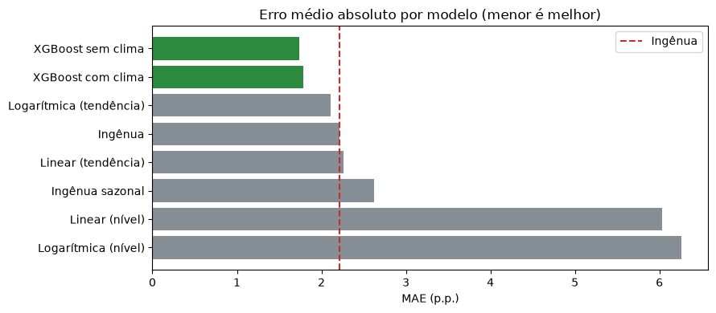
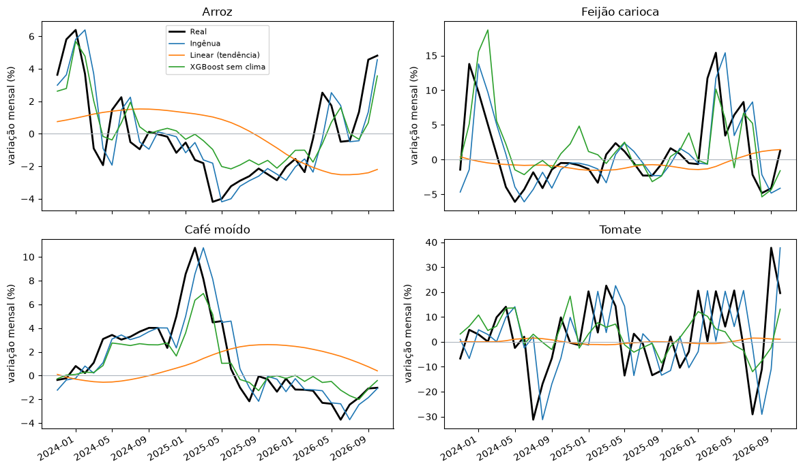

# E4 — Avaliação dos modelos de previsão

Resposta à pergunta: o modelo prevê a variação de preço do mês seguinte melhor do que regras
simples? Se não prever, não adianta usá-lo para recomendar reajuste ao lojista.

O notebook completo, com o código e todas as tabelas, é o
[`notebooks/avaliacao_modelos.ipynb`](https://github.com/Bappoz/inflatrack/blob/feat/modelo-reajuste/notebooks/avaliacao_modelos.ipynb).
Para refazer: `just modelo-notebook`. Ele regrava o notebook e os gráficos desta página.

## Como foi medido

- **Alvo:** a variação mensal do subitem do IPCA em t+1, para os 45 subitens dos produtos do
  atacadista. A praça é o Brasil. Nenhum preço em R$ é lido (ADR 0004).
- **Validação walk-forward:** em cada um dos 36 meses de nov/2023 a out/2026, todos os modelos
  são refeitos só com o que já se sabia no mês anterior. Não há divisão aleatória.
- **Métricas:** MAE e RMSE, em pontos percentuais. Todos os modelos são medidos nas mesmas 1.620
  previsões.
- **Código:** `src/inflatrack/predicao/` (`serie.py`, `modelos.py`, `walk_forward.py`), com testes
  em `tests/unit/test_predicao_*.py`. Um deles confere que nenhuma variável vem do futuro.

## Resultado (execução de 19/11/2026)

| Modelo | MAE | RMSE | Ganho sobre a ingênua |
|---|---|---|---|
| XGBoost sem clima | 1,734 | 3,898 | **+21,5%** |
| XGBoost com clima | 1,787 | 4,001 | +19,1% |
| Regressão logarítmica (tendência) | 2,109 | 4,644 | +4,6% |
| Ingênua (repete o mês anterior) | 2,209 | 5,037 | 0 |
| Regressão linear (tendência) | 2,258 | 4,842 | −2,2% |
| Ingênua sazonal (mesmo mês do ano anterior) | 2,619 | 5,304 | −18,5% |
| Regressão linear (nível) | 6,036 | 10,900 | −173% |
| Regressão logarítmica (nível) | 6,261 | 10,958 | −183% |

MAE por grupo:

| Modelo | Alimentação | Limpeza | Higiene |
|---|---|---|---|
| XGBoost sem clima | 2,027 | 0,600 | 0,518 |
| Ingênua | 2,586 | 0,731 | 0,670 |
| Regressão logarítmica (tendência) | 2,488 | 0,629 | 0,547 |

## Previsto contra real

A linha preta é a variação real de cada mês. A previsão ingênua (azul) repete a curva real com um
mês de atraso. A regressão linear pela tendência (laranja) só acompanha o ritmo médio. O XGBoost
(verde) fica mais perto da linha preta, mas no arroz e no café chega atrasado nas viradas.

## Conclusão

- **O XGBoost sem clima é o melhor modelo.** Ele é cerca de 21% melhor que repetir o mês anterior
  e ganha da ingênua nos três grupos.
- **Regressões linear e logarítmica:**
  - pela tendência (a taxa de crescimento da reta), ficam perto da ingênua: logarítmica +5%,
    linear −2%;
  - pelo nível (a reta contra o último índice real), erram cerca de 6 p.p., porque "puxam" o
    índice de volta para a reta;
  - a leitura pela tendência foi acrescentada depois que a leitura pelo nível foi mal. É uma régua
    mais justa e não favorece o XGBoost.
- **O clima piorou o XGBoost** (1,79 contra 1,73 p.p.).
  - O clima dos polos entra com o mês anterior, porque o mês corrente nem sempre está fechado
    quando a previsão é feita.
  - Pela Regra 8, o clima fica fora do modelo da fase de aplicação, até ser testado com as
    defasagens longas da Regra 4.
- **O XGBoost perde para a ingênua em 6 dos 45 subitens:**
  - arroz (−15%), café (−9%), feijão carioca (−3%), açúcar refinado e cristal (−2% cada) e
    margarina (−1%);
  - são produtos que seguem safra, câmbio e cotação internacional;
  - para eles, a aplicação pode usar a ingênua, ou um modelo próprio.
- **Onde o XGBoost mais ganha:** pão de forma (+35%), tomate (+33%) e batata (+31%).
  - Tomate e batata ainda erram cerca de 10 p.p. por mês, então a recomendação para eles deve vir
    com uma faixa.
- **Limites desta avaliação:**
  - 36 meses por produto: diferenças de poucos por cento são ruído, e não há teste de
    significância;
  - dólar e Selic só existem desde 2020, então ficam nulos em cerca de 60% do treino.
- **Próximo passo (fase de aplicação):**
  - usar o XGBoost sem clima, retreinado a cada IPCA novo, em todas as praças;
  - traduzir a variação prevista em R$ com `atacado.preco_atual` e gravar o resultado em
    `public.recomendacao_reajuste`.
