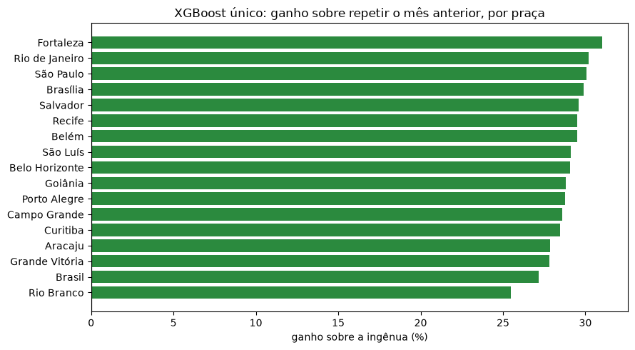
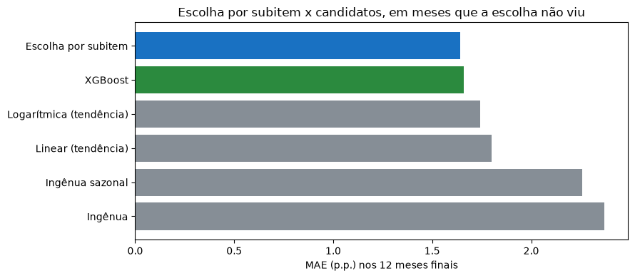

# E4 — Avaliação ampliada: todos os subitens, todas as praças

Ponto de parada antes de prever e publicar para o site
([design](https://github.com/Bappoz/inflatrack/blob/feat/aplicacao-modelo/docs/superpowers/specs/2026-11-19-aplicacao-modelo-supabase-design.md)).
A primeira avaliação ([E4 — modelos](avaliacao_modelos.md)) usou 45 subitens e só o Brasil.
Esta usa **todos os 478 subitens do IPCA nas 17 localidades** (16 praças e o Brasil).

O notebook completo é o
[`notebooks/avaliacao_todas_pracas.ipynb`](https://github.com/Bappoz/inflatrack/blob/feat/aplicacao-modelo/notebooks/avaliacao_todas_pracas.ipynb).
Para refazer: `just modelo-notebook`, que leva cerca de 8 minutos neste notebook.

## Como foi medido

- **Candidatos:**
  - ingênua (repete o mês anterior);
  - ingênua sazonal (repete o mesmo mês do ano anterior);
  - regressões linear e logarítmica pela tendência;
  - um **XGBoost único** para todas as praças, com a praça como variável.
- **Walk-forward de 36 meses** (nov/2023 a out/2026), com 6.509 séries de praça e subitem.
- **Escolha por subitem:** para cada subitem, juntando as praças, vence o candidato de menor
  erro. Onde o vencedor não prevê, usa-se a ingênua. A escolha é feita com os primeiros 24
  meses de teste e medida nos 12 seguintes, que ela não viu.

## Candidatos nos 36 meses

| Modelo | MAE (p.p.) | RMSE | Ganho sobre a ingênua |
|---|---|---|---|
| **XGBoost** | **1,699** | 3,384 | **+28,9%** |
| Regressão logarítmica (tendência) | 1,776 | 3,708 | +25,7% |
| Regressão linear (tendência) | 1,836 | 3,791 | +23,2% |
| Ingênua sazonal | 2,314 | 4,645 | +3,1% |
| Ingênua | 2,389 | 4,816 | 0 |

## A escolha por subitem, nos 12 meses que ela não viu

| Modelo | MAE (p.p.) | RMSE | Ganho sobre a ingênua |
|---|---|---|---|
| **Escolha por subitem** | **1,643** | 3,349 | **+30,7%** |
| XGBoost | 1,660 | 3,331 | +29,9% |
| Regressão logarítmica (tendência) | 1,743 | 3,651 | +26,5% |
| Ingênua | 2,370 | 4,759 | 0 |

Vencedores por subitem: XGBoost em 210, regressão logarítmica em 132, ingênua sazonal em 15,
regressão linear em 12 e ingênua em 8.

## Conclusão

- **O XGBoost único funciona em todas as praças.** Ele é 29% melhor que a ingênua no geral e
  ganha de 25% a 31% em cada uma das 17 localidades.
- **As regressões pela tendência melhoram com todos os subitens:** +26% (logarítmica) e +23%
  (linear). Serviços e preços administrados variam de forma regular, e a tendência os acompanha
  bem.
- **A escolha por subitem passa na regra de segurança:** ganha 31% da ingênua. Sobre o XGBoost
  sozinho, porém, o ganho é pequeno: cerca de 1% no MAE, e o RMSE fica um pouco pior.
- **Decisão pendente do integrante:** usar a escolha por subitem, como está no design, ou o
  XGBoost fixo, que é mais simples e quase igual.
