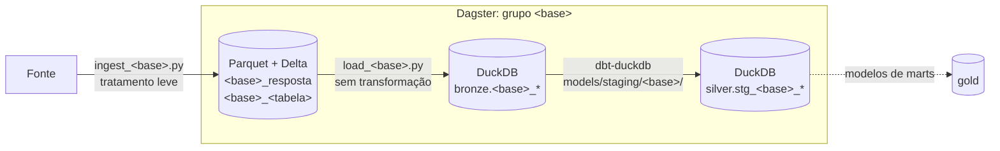

# Preparação da Bronze e da Silver por fonte

Plano de trabalho para deixar **as nove fontes de dados** (oito APIs públicas e o banco transacional) no mesmo padrão, cobrindo **toda a E2** e preparando a E3. Cada fonte é trabalhada **em paralelo por uma pessoa**. No final, as partes são juntadas e conectadas (seção 4.4).

> **Decisões de partida**
>
> - **Sem camada Raw como estrutura separada, sem perder a resposta original.** A pasta `data/raw/` e os arquivos `.json.gz` deixam de existir. A resposta de cada requisição passa a ser guardada inteira numa **tabela de respostas** da própria Bronze, em Parquet + Delta (seção 2.2).
> - **Padrão Parquet → DuckDB.** As linhas extraídas da resposta são carregadas sem transformação numa tabela do DuckDB. Essa tabela é a entrada do dbt.
> - **Tratamento no dbt-duckdb, orquestração no Dagster.** Toda regra de negócio sai do Python e vira modelo dbt. O Dagster executa as etapas no mesmo grafo.
> - **Tudo separado por fonte.** Cada fonte tem os próprios arquivos, tabelas, módulo no Dagster e pasta de modelos dbt (seção 2.1).
>
> O levantamento foi feito em 2026-10-11, a partir do código, de execuções reais pelo Dagster e da leitura de toda a documentação, inclusive as orientações da disciplina.

---

## 1. Entregas e como usar este plano

**Como ler as tarefas:**

- Cada fonte da seção 3 tem duas listas: **"E2"** e **"E3"**. A ordem é essa: primeiro tudo o que é da E2.
- As tarefas comuns e a integração estão na seção 4.
- A seção 4.1 lista os **contratos** que precisam sair primeiro, porque destravam o trabalho em paralelo. Enquanto eles não ficam prontos, cada pessoa adianta o que não depende deles: fixtures reais, testes e documentação da sua fonte.

'

## 2. Estrutura geral

### O fluxo de cada fonte

| Etapa                    | Onde                   | Quem escreve                         | Critério para promover à etapa seguinte                      |
| ------------------------ | ---------------------- | ------------------------------------ | ------------------------------------------------------------ |
| Fonte → tabelas Delta    | `data/parquet/<base>/` | `ingest_<base>.py`                   | Resposta não vazia, colunas esperadas, metadados preenchidos |
| Delta → Bronze no DuckDB | schema `bronze`        | `load_<base>.py`                     | Checagens da Bronze passando (2.3)                           |
| Bronze → Silver          | schema `silver`        | dbt-duckdb, `models/staging/<base>/` | Testes dbt do `stg_<base>_*` passando (2.4)                  |
| Silver → Gold            | schema `gold`          | dbt-duckdb, `models/marts/`          | Testes dos _marts_ e SLA de freshness (2.5)                  |

### 2.1 Separação por fonte: um nome, todos os artefatos

| Fonte                        | Id               | Ingestor                   | Carga                    | Esquema DuckDB                    | Módulo Dagster                           |
| ---------------------------- | ---------------- | -------------------------- | ------------------------ | --------------------------------- | ---------------------------------------- |
| IPCA/INPC (SIDRA)            | `ipca`           | `ingest_ipca.py`           | `load_ipca.py`           | `setup_duckdb_ipca.sql`           | `orchestration/assets/ipca.py`           |
| Dólar (BCB/Olinda)           | `dolar`          | `ingest_dolar.py`          | `load_dolar.py`          | `setup_duckdb_dolar.sql`          | `orchestration/assets/dolar.py`          |
| Selic (BCB/SGS)              | `selic`          | `ingest_selic.py`          | `load_selic.py`          | `setup_duckdb_selic.sql`          | `orchestration/assets/selic.py`          |
| Commodities (Alpha Vantage)  | `commodities`    | `ingest_commodities.py`    | `load_commodities.py`    | `setup_duckdb_commodities.sql`    | `orchestration/assets/commodities.py`    |
| PIB e setores (SIDRA 1846)   | `pib`            | `ingest_pib.py`            | `load_pib.py`            | `setup_duckdb_pib.sql`            | `orchestration/assets/pib.py`            |
| PIB da China (Banco Mundial) | `pib_china`      | `ingest_pib_china.py`      | `load_pib_china.py`      | `setup_duckdb_pib_china.sql`      | `orchestration/assets/pib_china.py`      |
| Salário mínimo (DIEESE)      | `salario_minimo` | `ingest_salario_minimo.py` | `load_salario_minimo.py` | `setup_duckdb_salario_minimo.sql` | `orchestration/assets/salario_minimo.py` |
| Clima (INMET)                | `clima`          | `ingest_clima.py`          | `load_clima.py`          | `setup_duckdb_clima.sql`          | `orchestration/assets/clima.py`          |
| Transacional (Postgres, CDC) | `transacional`   | `cdc_transacional.py`      | `load_transacional.py`   | `setup_duckdb_transacional.sql`   | `orchestration/assets/transacional.py`   |

O mesmo id aparece em:

- `data/parquet/<base>/` e `bronze.<base>_<tabela>`;
- `tests/test_<base>.py` e `tests/fixtures/<base>/`;
- `docs/fontes/<base>.md`, `docs/dicionario/<base>.md` e `docs/evidencias/e2/<base>.md`;
- `models/staging/<base>/`;
- `just bronze-<base>`.

**Um módulo do Dagster por fonte** é o que permite trabalhar em paralelo sem conflito de merge. Hoje todos os assets estão em `orchestration/assets/ingestao.py`, e qualquer mudança simultânea nesse arquivo conflita.

**O que hoje fere a separação:**

- Dólar e Selic dividem o `setup_duckdb_macro.sql`, o grupo `macro` e o job `macro_job` no Dagster, e a receita `seed-macro`.
- O esquema das commodities se chama `setup_duckdb.sql`, sem o nome da fonte.
- O ingestor do IPCA se chama `ingest.py`.
- O grupo do Dagster e a pasta de Parquet do salário mínimo se chamam `dieese`.

### 2.2 Fonte → Bronze: duas tabelas por fonte

O ingestor grava, no mesmo passo, **duas tabelas Delta**:

| Tabela                | Uma linha por                                                             | Para que serve                                                                                                                             |
| --------------------- | ------------------------------------------------------------------------- | ------------------------------------------------------------------------------------------------------------------------------------------ |
| **`<base>_resposta`** | Resposta **diferente** recebida da fonte                                  | Guardar a resposta original inteira, para reextrair qualquer coisa sem voltar à fonte. Substitui os `.json.gz` / `.html.gz` de `data/raw/` |
| **`<base>_<tabela>`** | Registro extraído da resposta (ex.: observação do IPCA, boletim do dólar) | Entrada do DuckDB e do dbt, já em colunas e tipada                                                                                         |

**Colunas da tabela de respostas:**

| Coluna                         | Conteúdo                                                     |
| ------------------------------ | ------------------------------------------------------------ |
| `id_resposta`                  | Identificador da resposta. Proposta: o próprio hash do corpo |
| `_fonte`                       | A fonte                                                      |
| `_requisicao`                  | URL e parâmetros usados                                      |
| `_ingerido_em`                 | Timestamp UTC da requisição                                  |
| `status_http`, `tipo_conteudo` | Status e `Content-Type` da resposta                          |
| `corpo`                        | A resposta inteira, como veio: JSON, HTML ou texto           |
| `hash_corpo`                   | SHA-256 do corpo                                             |
| `tamanho_bytes`                | Tamanho do corpo                                             |

**Regras da tabela de respostas:**

- **Uma resposta igual não é gravada de novo.** Pelo `hash_corpo`, só entra uma linha quando a resposta mudou. Assim a tabela guarda exatamente as versões diferentes que a fonte publicou, o que também registra as revisões.
- **Só acrescenta, sem limpeza de versões.** Nenhuma resposta é apagada, e não se roda `VACUUM` nessa tabela.
- **Fica no Delta e não é copiada para o DuckDB.** Quando alguém precisar, o DuckDB lê com `delta_scan`.
- **Resposta de erro ou vazia não entra:** a execução falha antes de gravar.

**Tabela extraída:** cada linha traz `_id_resposta`, `_fonte`, `_requisicao` e `_ingerido_em`. Juntas, elas são a linhagem até a fonte que a E4 cobra.

**Tratamento leve na tabela extraída:**

| Pode no ingestor                                         | Vai para o dbt                                                                       |
| -------------------------------------------------------- | ------------------------------------------------------------------------------------ |
| Achatar o JSON/HTML em linhas e colunas                  | Preencher dias sem dado (_forward fill_) e marcar `observado`                        |
| Renomear para `snake_case`                               | Escolher um entre vários registros (ex.: o boletim de fechamento)                    |
| Converter tipos (texto → data, texto → número)           | Descartar linhas (marcadores, valores ≤ 0, meses fora do mapa)                       |
| Marcador de ausente → `valor` nulo, **mantendo a linha** | Classificar, enriquecer, derivar colunas (grupos, razões, ano/trimestre, acumulados) |
| Manter todos os campos que a fonte manda                 | Juntar com outra fonte, pivotar                                                      |
| Nunca inventar valor padrão para campo ausente           | Imputar valor (ex.: média regional)                                                  |

**`valor_bruto` só onde há marcadores** (IPCA e PIB, que vêm do SIDRA). No SIDRA, `-` pode ser zero absoluto ([fontes/sidra.md](../fontes/sidra.md)). A coluna é um atalho para o dbt; a garantia de não perder nada é da tabela de respostas.

**Formato e local:** `data/parquet/<base>/resposta/` e `data/parquet/<base>/<tabela>/`, como tabelas **Delta** (ou Iceberg, se o ADR 0004 preferir). O Delta entrega escrita atômica, regravação de partição e versões sem código à mão. O particionamento é escolhido pela medição de 4.2, para evitar "milhares de arquivos pequenos", que a E2 aponta como erro recorrente.

**Dado pessoal fica fora:** o `cnpj` do lojista é dado pessoal pela LGPD ([dicionario/transacional.md](../dicionario/transacional.md)) e não entra em tabela analítica, nem pelo CDC.

### 2.3 Delta → DuckDB: a carga Bronze

A carga **não transforma nada**: espelha a tabela extraída em `bronze.<base>_<tabela>` no arquivo único `data/duckdb/inflatrack.duckdb`.

| Modo                   | Como                                                       | Quando usar                                                                                  |
| ---------------------- | ---------------------------------------------------------- | -------------------------------------------------------------------------------------------- |
| **Substitui partição** | `DELETE` da partição e `INSERT ... SELECT`, numa transação | Fonte sem revisão relevante, ou série que chega completa a cada chamada                      |
| **Só acrescenta**      | `INSERT` só do que é novo, com a chave incluindo o valor   | Fonte que **revisa valor publicado**. É a regra do [ADR 0001](../arquitetura.md) para o IPCA |

**Regras da carga:**

- Sem `ON CONFLICT` por chave de negócio, porque a Bronze pode ter mais de um registro por chave.
- Sem dimensões nem views na carga: elas vão para o dbt como _seeds_ e modelos.
- O esquema vem de `scripts/setup_duckdb_<base>.sql`, aplicado pela própria carga.
- A carga e os assets dbt ficam no pool `duckdb_writer` do Dagster (limite 1).
- **Checagens da Bronze:** não vazia, colunas e tipos esperados, partição sem buraco e volume dentro da faixa de referência da fonte.

**Transição:** as tabelas atuais do schema `main` (`dolar_cotacao`, `pib_valor`, `vw_features_daily`...) ficam até o modelo dbt equivalente existir. Elas são lidas por `src/dados_duck.py`, e as tabelas `observacao` e `classificacao_versao` do Postgres atendem as consultas C1–C5.

### 2.4 Bronze → Silver: o que cada `stg_<base>` precisa ter

- **Granularidade declarada por extenso**, como "uma linha por subitem por localidade por mês".
- **Testes de esquema, volume, unicidade, integridade referencial e ao menos um de distribuição.** Os testes sugeridos estão em cada fonte. Eles substituem `sql/verificar_carga.sql`.
- **Source com freshness** sobre `_ingerido_em` (2.5).
- **Regras que saem do Python**, listadas em "dbt" em cada fonte.

### 2.5 Freshness e SLA por fonte (proposta)

| Fonte              | Chega                                | Freshness                        | Observação                                 |
| ------------------ | ------------------------------------ | -------------------------------- | ------------------------------------------ |
| IPCA/INPC          | Mensal, dias 9–12                    | Até o dia 15 do mês seguinte     | Calendário do IBGE                         |
| Dólar              | Dias úteis                           | D+1 útil                         | O valor do dia muda até o fechamento       |
| Selic              | Dias úteis                           | D+1 útil                         | A taxa só sai no dia útil seguinte         |
| Commodities        | Diária (energia), mensal (agrícolas) | D+2 (energia)                    | Cota de 25 req./dia                        |
| PIB                | Trimestral                           | 100 dias após o fim do trimestre | A confirmar                                |
| PIB da China       | Anual, com revisões                  | 1 mês                            | Revisão fora de calendário                 |
| Salário mínimo     | Mensal, 1ª quinzena do mês seguinte  | Dia 20 do mês seguinte           |                                            |
| Clima              | Diária                               | D+2                              | Depende da validação da API                |
| Transacional (CDC) | Contínua                             | Minutos                          | Depende do mecanismo escolhido no ADR 0004 |

O SLA de consumo exigido pela E3 vale para a tabela Gold que responde à pergunta de gestão; o candidato natural é o fato do IPCA.

### 2.6 Dado atrasado e reprocessamento de janela (proposta de partida)

Cada pessoa confirma ou ajusta a linha da sua fonte e escreve o texto para o ADR 0004.

| Fonte                                     | Revisa o passado?                                 | Janela relida a cada execução                                                   |
| ----------------------------------------- | ------------------------------------------------- | ------------------------------------------------------------------------------- |
| IPCA/INPC                                 | Sim, o IBGE revisa valor publicado                | Mês corrente e os 3 anteriores; revisão vira linha nova (só acrescenta)         |
| PIB                                       | Sim, cada divulgação revisa trimestres anteriores | Ano corrente e o anterior (o histórico inteiro são 32 requisições em ~9 s)      |
| Dólar e Selic                             | Raramente                                         | Ano corrente, e os 10 dias anteriores ao início da janela para o _forward fill_ |
| Commodities, PIB da China, Salário mínimo | A série chega inteira                             | A série inteira; a tabela de respostas guarda cada versão diferente             |
| Clima                                     | Estações retransmitem com atraso                  | Últimos 7 dias, a confirmar na validação da API                                 |
| Transacional (CDC)                        | Transação longa faz commit depois de outras       | Ordem pelo `lsn` do WAL, não pelo relógio; o destino guarda o momento do commit |

### 2.7 Como a Bronze cobre o que o Raw garantia

| O que o Raw garantia                                | Como fica                                                                                                                  |
| --------------------------------------------------- | -------------------------------------------------------------------------------------------------------------------------- |
| Reprocessar uma regra errada sem chamar a API       | Pela tabela extraída ou, completo, pelo corpo na tabela de respostas                                                       |
| Testar um parser corrigido contra respostas antigas | O corpo das respostas antigas fica guardado; as fixtures dos testes saem dali                                              |
| Valor anterior a uma revisão                        | Cada resposta diferente vira uma linha na tabela de respostas; o IPCA também é só acrescenta                               |
| Histórico já baixado                                | Importação de todo o `data/raw/` para as tabelas de respostas antes de apagar                                              |
| Trabalhar se a fonte sumir para sempre              | A tabela de respostas guarda tudo o que a fonte devolveu, **desde que haja cópia fora desta máquina** (4.3) e sem `VACUUM` |

Só existe o que foi pedido à fonte: dado nunca requisitado (outra localidade, outra variável, outra estação) não está em lugar nenhum.

---

## 3. Tarefas por fonte

Cada fonte é independente das outras até a integração (4.4). Todas usam o helper e as convenções da seção 4.1.

**Valem para toda fonte e não se repetem abaixo:**

- [ ] (E2) Sua parte do diário de bordo das Semanas 7 a 10.
- [ ] (E2) A evidência da sua fonte em `docs/evidencias/e2/<base>.md`: comando, saída da demonstração de reexecução e checagens.
- [ ] (E3) `docs/fontes/<base>.md` e `docs/dicionario/<base>.md` descrevendo as duas tabelas e a tabela Bronze, sem citar o Raw.
- [ ] (E3) Mover os assets da sua fonte para `orchestration/assets/<base>.py`, no padrão de 4.1.
- [ ] Todo PR revisado por outra pessoa da Squad, e registro no `AI-USAGE.md` quando usar IA.

### 3.1 IPCA/INPC (SIDRA)

**Hoje:** `ingest.py` baixa os agregados 2938, 1419, 7060 (IPCA), 7063 (INPC) e 1737 (número-índice), grava o `.json.gz` em `data/raw/ipca-inpc/` (886 arquivos, ~46 MB) e insere direto no Postgres, descartando ~30% das linhas (marcadores). Não passa pelo DuckDB. No Postgres, `observacao` é _insert-only_ (ADR 0001). No Dagster são três assets particionados por mês.

**E2:**

- [x] `transformar(payload)` em Python, mantendo todos os campos do SIDRA (localidade, variável, unidade, categoria da classificação 315, mês) e **todas as linhas**, com `valor` nulo e `valor_bruto` para os quatro marcadores (`...`, `..`, `-`, `X`). São **~31 mil linhas por mês** no 7060.
- [x] Gravar `ipca_resposta` e `ipca_observacao` em Delta pelo ingestor, **sem tirar ainda a escrita no Postgres** (ela sai só na E3). O IPCA é a fonte central: sem isso, o caminho em lote mais importante não chega ao formato aberto.
- [x] Importar os 886 `.json.gz` para `ipca_resposta`, reconstruindo `_requisicao` pelo nome do arquivo (agregado e mês), e extrair ao menos o 7060 para `ipca_observacao`.
- [x] Demonstração de reexecução: a mesma partição duas vezes não acrescenta linha. Já observado em 2026-10-11: reexecutar set/2026 do INPC deu "0 linhas novas".
- [x] Política de dado atrasado (2.6): revisão do IBGE e mês ainda não publicado (o agendamento tenta nos dias 9–13 até o mês sair).
- [x] Checagens de esquema e volume: 17 localidades (12 no 2938), variáveis 63, 66, 69 e 2265 no 7060 (a 2266 só existe no 1737), 31.076 linhas por mês no 7060.

Evidência de cada item, com comando e saída: [evidencias/e2/ipca.md](../evidencias/e2/ipca.md). Feito num módulo da própria fonte (`bronze_ipca.py`), porque o helper comum de 4.1 ainda não existe.

**E3:**

- [ ] Extrair também 2938, 1419, 7063 e 1737. O 1737 tem uma linha por mês e pode ser baixado inteiro, em vez de ~560 requisições.
- [ ] Gravar os metadados do agregado (árvore de categorias da cesta) em `ipca_metadados`.
- [ ] `load_ipca.py` e `bronze.ipca_observacao` em modo só acrescenta; `bronze.ipca_metadados`.
- [ ] Tirar a escrita no Postgres do ingestor. Um asset _downstream_ da Bronze passa a popular `classificacao`, `classificacao_versao` e `observacao`, com a mesma semântica _insert-only_. O Postgres continua obrigatório, por causa das FKs do lojista, da consulta C5 e do CDC.
- [ ] Renomear `ingest.py` para `ingest_ipca.py`; `tests/test_ipca.py` com fixtures reais do 7060 e do 1737.
- [ ] dbt:
  - descarte dos marcadores e interpretação do `-`;
  - de-para da categoria para o código da cesta;
  - união 2938 → 1419 → 7060, com teste de continuidade;
  - acumulado em 12 meses do 2938;
  - _seeds_ `fonte_agregado`, `variavel` e `localidade`.
- [ ] dbt: **dimensão de variação lenta da cesta**, exigida pela E3, e o fato "uma linha por subitem × localidade × mês".
- [ ] Testes dbt: localidades por agregado, `mes_referencia` no dia 1, e **distribuição** (variação mensal fora da faixa num subitem indica salto de série).

### 3.2 Dólar (BCB/Olinda)

**Hoje:** `ingest_dolar.py` grava `data/raw/bcb/dolar_*.json.gz` e escreve direto em `main.dolar_cotacao`, pulando o Parquet. No caminho, mantém o último boletim do dia, preenche fins de semana e feriados, marca `observado` e consulta 10 dias antes da janela ([ADR 0003](../adr/0003-bcb-macro.md)).

**E2:**

- [ ] Gravar `dolar_resposta` e `dolar_boletim` em Delta, com **todos os boletins** (`data_hora_cotacao`, `cotacao_compra`, `cotacao_venda` e `tipo_boletim`, hoje descartado), partição por ano. A escrita em `main.dolar_cotacao` continua por enquanto.
- [ ] Importar os `data/raw/bcb/dolar_*.json.gz` para `dolar_resposta`.
- [ ] Demonstração de reexecução: rodar duas vezes no mesmo dia não grava resposta nova (hash) e não muda a contagem de boletins.
- [ ] Política de dado atrasado: o valor do dia muda até o fechamento; a janela relida é o ano corrente.
- [ ] Checagens: ao menos um boletim por dia útil; compra e venda não nulas.

**E3:**

- [ ] Tirar do ingestor a escrita no DuckDB; `load_dolar.py`, `setup_duckdb_dolar.sql` e `bronze.dolar_boletim`.
- [ ] Separar da Selic o `setup_duckdb_macro.sql` e a receita `seed-macro`, combinando com quem cuida da Selic.
- [ ] dbt:
  - fechamento escolhido por `tipo_boletim`;
  - _forward fill_ com `observado`;
  - aborto sem cotação anterior;
  - tratamento do dia corrente;
  - **modelo que preserva os boletins do dia**, para a volatilidade "intraday" da consulta C10.
- [ ] Testes dbt: `data_referencia` único no modelo diário e **distribuição** (`observado = false` entre ~30% e 35%).
- [ ] `test_dolar_olinda.py` → `test_dolar.py` com resposta real; revisar o ADR 0003 e `fontes/dolar.md`.

### 3.3 Selic (BCB/SGS)

**Hoje:** grava `data/raw/bcb/selic_*.json.gz` e `main.selic_taxa` direto, preenchendo os dias sem taxa e marcando `observado`. Pula o Parquet.

**E2:**

- [ ] Gravar `selic_resposta` e `selic_taxa_dia` em Delta, com `data` e `valor` só tipados e sem preencher dias, partição por ano. A escrita em `main.selic_taxa` continua por enquanto.
- [ ] Importar os `data/raw/bcb/selic_*.json.gz` para `selic_resposta`.
- [ ] Demonstração de reexecução e política de dado atrasado: a taxa do dia só sai no dia útil seguinte.
- [ ] Checagens: uma linha por dia útil; taxa na ordem de 0,05 (% ao dia).

**E3:**

- [ ] `load_selic.py`, `setup_duckdb_selic.sql` e `bronze.selic_taxa_dia`; separar do `macro`.
- [ ] dbt: _forward fill_ com `observado` e erro quando falta valor anterior.
- [ ] Teste dbt de **distribuição/faixa**, que pega quem confundir com a meta Selic (série 432).
- [ ] `test_selic_sgs.py` → `test_selic.py` com resposta real; atualizar `fontes/selic.md`.

### 3.4 Commodities (Alpha Vantage)

**Hoje:** grava o Raw em `data/raw/commodities_raw/` e um Parquet por commodity na raiz de `data/parquet/`. `load_commodities.py` faz upsert e preenche a dimensão `commodity` a partir de um dicionário no código. Erros e cota esgotada são só registrados no log.

**E2:**

- [ ] **Parar de engolir erros.** Cota esgotada (resposta 200 com mensagem no lugar dos dados), campo `data` ausente e lista vazia viram falha. Sem isso, a demonstração de reexecução não é confiável.
- [ ] Gravar `commodities_resposta` e `commodities_cotacao` em Delta em `data/parquet/commodities/`, mantendo as linhas `"."` com valor nulo e guardando `name`, `interval` e `unit`.
- [ ] Importar `data/raw/commodities_raw/` para `commodities_resposta`.
- [ ] Demonstração de reexecução: a segunda execução não grava resposta nova para séries que não mudaram. **Cada execução completa gasta 9 das 25 requisições diárias.**
- [ ] Política: a série chega inteira; cada versão diferente fica na tabela de respostas.
- [ ] Checagens: 9 símbolos, `(symbol, data_referencia)` único, volume de referência de 26.781 linhas.

**E3:**

- [ ] Padronizar o módulo: `main(argv) -> int`, sem `logging.basicConfig` na importação, `ruff` limpo (destrava o `just check`); remover o modo `historico`/`incremental`.
- [ ] `load_commodities.py` para `bronze.commodities_cotacao`, sem dimensão; `setup_duckdb.sql` → `setup_duckdb_commodities.sql`.
- [ ] dbt: _seed_ `commodity` e as views de features como modelos, com as colunas geradas a partir do seed.
- [ ] Testes do ingestor com respostas reais de WTI, CORN e da cota esgotada; teste dbt de **distribuição** (preço ≤ 0).
- [ ] Atualizar `como_rodar/cr_commodities.md`.

### 3.5 PIB e setores (SIDRA 1846)

**Hoje:** grava o Raw em `data/raw/pib_raw/` e um Parquet por ano em `data/parquet/pib/` (2.806 linhas em 1996–2026). No caminho, descarta marcadores, calcula `ano` e `trimestre` e classifica `grupo`/`nucleo` por um catálogo no código. É a fonte mais perto do padrão e serve de piloto do helper (4.1).

**E2:**

- [ ] Primeira fonte a usar o helper: `pib_resposta` e `pib_valor` em Delta, com código e nome do setor como o SIDRA manda, todas as linhas e `valor_bruto`.
- [ ] Importar `data/raw/pib_raw/` para `pib_resposta`.
- [ ] Demonstração de reexecução e política: cada divulgação revisa trimestres anteriores, então a janela relida é o ano corrente e o anterior.
- [ ] Checagens: 23 categorias por trimestre; 2.806 linhas em 1996T1–2026T2.

**E3:**

- [ ] Pular só o ano corrente sem dados e falhar num ano passado vazio.
- [ ] `bronze.pib_valor`; `tests/test_pib.py` (hoje não existe).
- [ ] dbt:
  - _seed_ `grupo`/`nucleo` com teste de relacionamento;
  - `ano`/`trimestre`;
  - dimensão `pib_setor`;
  - as três views como modelos.
- [ ] Teste dbt de **distribuição**: variação trimestral fora da faixa histórica.

### 3.6 PIB da China (Banco Mundial)

**Hoje:** grava o Raw dos dois indicadores e junta os dois por ano em formato largo, descartando `indicator`, `country`, `unit`, `obs_status` e `decimal`. Já trata resposta vazia e malformada como erro.

**E2:**

- [ ] `pib_china_resposta` (uma resposta por indicador, com o cabeçalho `payload[0]` no corpo) e `pib_china_indicador` em Delta, em **formato longo** (`indicador`, `ano`, `valor` e os campos hoje descartados).
- [ ] Importar o Raw existente para `pib_china_resposta`.
- [ ] Demonstração de reexecução e política: a série chega inteira e pode ser revisada fora de calendário.
- [ ] Checagens: `(indicador, ano)` único, ~60 a 65 anos desde 1960, último ano anulável.

**E3:**

- [ ] `bronze.pib_china_indicador`; dbt: pivô para formato largo e `atualizado_em` a partir de `_ingerido_em`.
- [ ] Trocar o payload inventado de `tests/test_pib_china.py` por uma resposta real.

### 3.7 Salário mínimo (DIEESE)

**Hoje:** baixa o HTML, grava em `data/raw/dieese/` e extrai para `data/parquet/dieese/` (387 meses). No caminho, descarta sem aviso meses fora de `MAPA_MESES` e valores ≤ 0, e calcula `multiplo_necessario_nominal`.

**E2:**

- [ ] `salario_minimo_resposta` (o HTML inteiro) e `salario_minimo_mes` em Delta, com **todas as linhas** da tabela HTML e sem a coluna calculada.
- [ ] Importar os `.html.gz` de `data/raw/dieese/` para `salario_minimo_resposta`.
- [ ] Demonstração de reexecução e política: a divulgação sai na 1ª quinzena do mês seguinte, sem dia fixo; a página traz a série inteira.
- [ ] Checagens: `ano_mes` único, série desde 1994-07.

**E3:**

- [ ] `bronze.salario_minimo_mes`; grupo `dieese` → `salario_minimo`; agendamento tolerante na 1ª quinzena.
- [ ] HTML real em `tests/fixtures/salario_minimo/`, tirado da tabela de respostas; `test_dieese.py` → `test_salario_minimo.py`.
- [ ] dbt: filtro de meses inválidos e ≤ 0, `multiplo_necessario_nominal` e junção com o IPCA por `data_referencia`.
- [ ] Teste dbt de **distribuição**: valores > 0 e necessário ≥ nominal.
- [ ] Corrigir em `fontes/salario_minimo.md` a retenção de "5 anos".

### 3.8 Clima (INMET)

**Hoje:** só o cadastro de estações é baixado (671 estações). As medições diárias nunca são baixadas, e `main.clima_diario` está vazia. O transformador inventa valores padrão (`tipo`, `situacao`, `observado`) e transforma 0 °C em nulo (testado em 2026-10-11).

**E2:**

- [ ] **Validar a API de medições.** Em 2026-10-11, os endpoints de medições e de estações fecharam a conexão sem resposta. Descobrir se exige token, qual é o limite e qual é o formato real, e registrar na evidência.
- [ ] `clima_resposta` e `clima_estacao` em Delta para o cadastro de estações, sem valores padrão inventados.
- [ ] Importar `data/raw/inmet/` para `clima_resposta`.
- [ ] Demonstração de reexecução e política provisória (retransmissão nos últimos 7 dias).
- [ ] Checagens: estações únicas por `estacao_id`; ~671 estações.

**E3:**

- [ ] Ingestão das medições em `clima_medicao`, particionada por mês ou ano. A requisição é por estação e período, em blocos de até 1 ano.
- [ ] Corrigir o 0 → nulo; backfill do histórico depois da decisão da Squad (estações e período).
- [ ] `bronze.clima_estacao` e `bronze.clima_medicao`.
- [ ] dbt: `observado = false` como imputação regional, preferência por estações automáticas e **de-para estação → localidade do IPCA**, para a consulta C7.
- [ ] Testes dbt: `(estacao_id, data_referencia)` único, FK para a estação, **distribuição/faixa** (`temp_min ≤ temp_max`, umidade 0–100, chuva ≥ 0), ~600 linhas por dia.
- [ ] `test_inmet.py` → `test_clima.py` com respostas reais.

### 3.9 Transacional (Postgres) — captura de mudanças (CDC)

**Hoje:** o Postgres 16.4 do projeto já traz os plugins de decodificação lógica `test_decoding` e `pgoutput`, mas está com `wal_level = replica` (verificado em 2026-10-11). As tabelas transacionais são `lojista`, `produto`, `produto_preco_atual` e `reajuste`. Não existe fluxo de CDC, e a E2 cobra um.

**E2:**

- [ ] `wal_level=logical` no serviço `db` do `docker-compose.yml` (exige recriar o container; o volume com os dados continua).
- [ ] Migration nova com `REPLICA IDENTITY FULL` nas quatro tabelas, para `UPDATE` e `DELETE` trazerem o valor antigo.
- [ ] Protótipo dos dois mecanismos, para o ADR 0004 comparar:
  - Debezium (Kafka + Kafka Connect), que o enunciado cita;
  - slot lógico lido por SQL com `pg_logical_slot_peek_changes` e avanço por `pg_replication_slot_advance`, rodando com o `psycopg` do projeto.
- [ ] Consumidor que grava as mudanças em Delta na tabela `transacional_mudanca`, com `lsn`, operação, tabela, valores antigos e novos e momento do commit. **Sem o `cnpj`** (LGPD).
- [ ] **Serialização do fluxo:** escolher e justificar o formato das mudanças no caminho (texto do `test_decoding`, binário do `pgoutput`, JSON ou Avro no Debezium) e o formato no destino.
- [ ] **Script que altera linhas no Postgres** (cria um produto, muda o preço, apaga um produto) e mostra as três mudanças chegando ao destino. O enunciado aponta "CDC que nunca viu uma mudança" como erro recorrente.
- [ ] **Demonstração da semântica:** interromper entre gravar e avançar o slot, rodar de novo e mostrar que nada duplicou (deduplicação por `lsn`). Ler com `pg_logical_slot_get_changes`, que avança na leitura, daria **no máximo uma vez**.
- [ ] Medir a latência e o custo operacional de cada mecanismo e entregar ao ADR 0004.
- [ ] Política de atraso: a ordem vem do `lsn`; o destino guarda o momento do commit.
- [ ] Checagens: toda mudança tem `lsn` único e operação válida.

**E3:**

- [ ] Asset Dagster (ou sensor) que roda o consumidor de forma contínua ou agendada.
- [ ] `load_transacional.py` e `bronze.transacional_mudanca`.
- [ ] dbt: o histórico de `produto_preco_atual` como **dimensão de variação lenta** (preço por vigência), candidata ao lado da cesta do IPCA.
- [ ] Testes dbt: unicidade por `lsn`, integridade com as tabelas de referência do IPCA.

---

## 4. Tarefas comuns e integração

### 4.1 Contratos que destravam o trabalho em paralelo (fazer primeiro)

- [ ] **`inflatrack/bronze.py`** (com a fonte piloto, 3.5):
  - gravar a tabela de respostas: corpo, `hash_corpo`, sem repetir resposta igual;
  - gravar a tabela extraída com os metadados;
  - importar arquivos antigos de `data/raw/`;
  - os dois modos de carga no DuckDB.

  Usa Delta (ou Iceberg, conforme o ADR 0004).

- [ ] **Um módulo Dagster por fonte:** `orchestration/definitions.py` passa a carregar automaticamente todo módulo de `orchestration/assets/`, e cada fonte cria o seu sem mexer nos outros. Um exemplo pronto (o PIB) serve de modelo.
- [ ] **Modelo da evidência** `docs/evidencias/e2/<base>.md`: comando executado, saída da reexecução, contagens antes e depois, checagens.
- [ ] **Esqueleto do projeto dbt-duckdb:**
  - `dbt_project.yml` e `profiles.yml`;
  - schemas `silver` e `gold`;
  - `models/staging/<base>/` com um `_sources.yml` de exemplo;
  - integração `dagster-dbt`.

  Pode ficar para depois da E2, mas deve sair antes de todos começarem os `stg_<base>`.

### 4.2 E2 — tarefas comuns

- [ ] **ADR 0004 — mecanismo de ingestão**, no formato da disciplina. Inclui:
  - ≥ 3 alternativas: recarga periódica / `INSERT ... SELECT` agendado (opção nula), slot lógico lido por SQL e Debezium;
  - latência e custo medidos (3.9);
  - a escolha Delta × Iceberg pelo critério do enunciado (evolução de esquema e ecossistema de leitura);
  - a semântica de entrega de cada caminho;
  - as políticas de dado atrasado das nove fontes;
  - a serialização do CDC;
  - o que se perde e um gatilho de revisão.
- [ ] **Medições para o ADR**, com dados reais das tabelas Delta:
  - compressão snappy × zstd × gzip (tamanho e tempo de leitura no DuckDB);
  - número de arquivos por esquema de partição (IPCA por mês daria ~900 arquivos; Clima por dia, centenas por ano);
  - quantas respostas iguais o hash evita em uma semana de commodities e dólar;
  - `.json.gz` × tabela de respostas em espaço.
- [ ] **Subir do zero com um comando:**
  - `docker compose up` traz o Postgres com `wal_level=logical`, as migrations e o CDC;
  - uma receita (`just e2`) roda a ingestão de todas as fontes e o consumidor do CDC;
  - um README "Como reproduzir a E2" lista o que precisa de configuração (chave da Alpha Vantage, cota de 25 req./dia, API do INMET).
- [ ] **Teste a partir de um `git clone` limpo** antes de criar a tag, por alguém que não escreveu o código.
- [ ] **Consolidar o diário de bordo** das Semanas 7 a 10 e criar a tag `e2` no commit entregue.

### 4.3 E3 — tarefas comuns

- [ ] **ADR 0005 — fim da camada Raw separada e Bronze com tabela de respostas + tabela extraída → DuckDB → dbt.** Alternativas:

| Alternativa                                               | O que guarda                        | Problema                                                                       |
| --------------------------------------------------------- | ----------------------------------- | ------------------------------------------------------------------------------ |
| Manter o Raw em `.json.gz` (opção nula)                   | Resposta inteira                    | Formato e pasta à parte, fora do Delta, sem versões, um arquivo por requisição |
| Só a tabela extraída                                      | Só o que foi extraído               | Perde o que ficou fora da extração                                             |
| Resposta repetida em cada linha                           | Resposta inteira                    | Granularidade errada                                                           |
| Tabela de respostas com hash + tabela extraída (proposta) | Resposta inteira e linhas extraídas | Uma tabela a mais por fonte                                                    |
O ADR fixa ainda o nome das colunas de metadado (o [Contrato das Etapas](contratoEtapas.md) usa `data_ingestao`) e o prefixo das tabelas (o [ADR 0002](../adr/0002-duckdb-unico.md) usa `commodity_*`, `pib_*`).

- [ ] **ADR da E3** (modelagem analítica ou ferramenta de transformação), com `cron` + SQL como opção nula.
- [ ] **Dagster:** asset checks padrão em toda tabela `bronze.*`, freshness de 2.5 e pool `duckdb_writer` também nos assets dbt.
- [ ] **Demonstrações da E3, com roteiro versionado:** retry com dependência derrubada de propósito (já testado com o Postgres parado) e backfill de um intervalo de partições.
- [ ] **Consulta otimizada** com plano de execução antes e depois, versionado. Candidata: a série do IPCA por subitem e localidade. O DuckDB não aceita `EXPLAIN (ANALYZE, BUFFERS)`, então essa versão roda no Postgres.
- [ ] **SLA de consumo** declarado para a tabela Gold da pergunta de gestão.
- [ ] **Revisar a documentação que descreve o Raw:**
  - Medallion, Fluxo de Dados, Componentes e Visão Geral;
  - Contrato das Etapas, que diz que o dbt lê o Parquet com `read_parquet()` e chama as etapas de "E1"/"E2", o que se confunde com as Entregas;
  - Orquestração e ADRs 0002 e 0003;
  - `dicionario.md`, onboarding, README e `implementation_plan.md`.
- [ ] **Transição de `main`:** apagar tabela, view e upsert de cada fonte só quando o modelo dbt equivalente existir.
- [ ] **Apagar `data/raw/`** só depois que todas as fontes confirmarem a importação, com as opções `--raw-dir` e as entradas do `.gitignore`.
- [ ] **Cópia de segurança de `data/parquet/` fora desta máquina:** onde e com que frequência. As tabelas de respostas são a única cópia do que as fontes disseram.
- [ ] **`justfile`:** `bronze-<base>` por fonte e `bronze` para todas, testado a partir de um clone limpo.

### 4.4 Integração: juntar e conectar

Ao fim de cada Entrega, depois que as fontes terminam em paralelo:

- [ ] **Conferir as convenções em todas as fontes:** nomes de tabela, colunas de metadado, local dos arquivos e módulo Dagster.
- [ ] **Rodar tudo do zero** numa máquina limpa: `docker compose up`, a receita de todas as fontes e o CDC. Conferir as checagens de cada fonte.
- [ ] **Grafo único no Dagster:** todos os grupos carregados, sem asset duplicado, e o pool `duckdb_writer` serializando as escritas.
- [ ] **Conexões entre fontes** (E3):
  - modelos de _marts_ que cruzam fontes, como IPCA × dólar (C6), IPCA × clima com o de-para (C7), IPCA × PIB (C8) e IPCA × salário mínimo;
  - chaves de junção por `data_referencia`;
  - testes de integridade entre fontes.
- [ ] **Juntar as evidências** de `docs/evidencias/e2/` numa página só, ligada no menu da documentação.
- [ ] **Criar a tag** da Entrega no commit integrado.

### 4.5 Decisões que ficam com a Squad

- [ ] Delta ou Iceberg (ADR 0004).
- [ ] Debezium ou slot lógico lido por SQL (ADR 0004).
- [ ] Estações do INMET e período do histórico (3.8).
- [ ] Cesta básica do DIEESE: entra como segunda tabela da fonte ou o nome da fonte muda (3.7).
- [ ] Onde fica a cópia de segurança de `data/parquet/` (4.3).
- [ ] Lacunas que as consultas expõem fora das fontes atuais:
  - vendas do lojista ou do setor (C10, C11), que não existem em `migrations/`;
  - a marcação de subitem "importado" (C6, C10);
  - a cópia publicada da Gold para o Streamlit, que hoje lê `main` direto.

## Tarefas comuns sem dono fixo

Estas tarefas da seção 4 não têm um pacote, porque são feitas por quem estiver disponível ou pela Squad junta:

- [ ] **Subir do zero com um comando** e o README de reprodução da E2 ([plano, 4.2](preparacao_bronze.md#42-e2-tarefas-comuns)). O P8 garante que o `docker compose up` traz o CDC, e cada pessoa acrescenta a sua fonte à receita `just e2`.
- [ ] **Teste a partir de um `git clone` limpo** antes de criar a tag `e2`, feito por alguém que não escreveu o código. Sugestão: o P2 testa a entrega do P1, e assim por diante.
- [ ] **Integração** ([plano, 4.4](preparacao_bronze.md#44-integracao-juntar-e-conectar)): a Squad junta, ao fim de cada Entrega.
